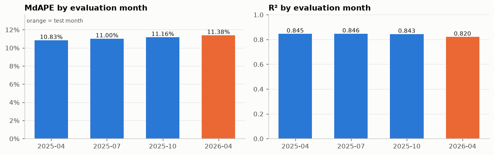
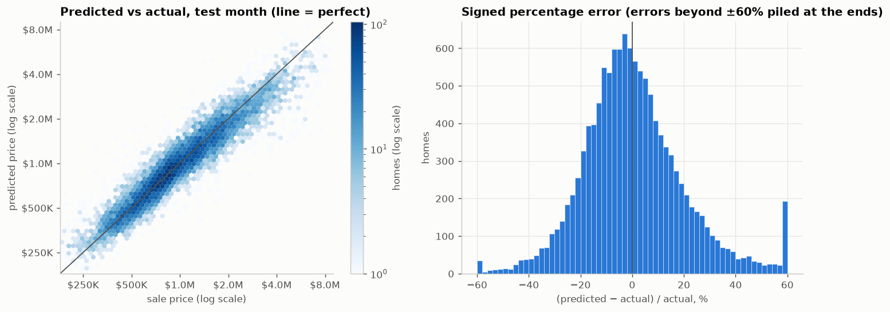
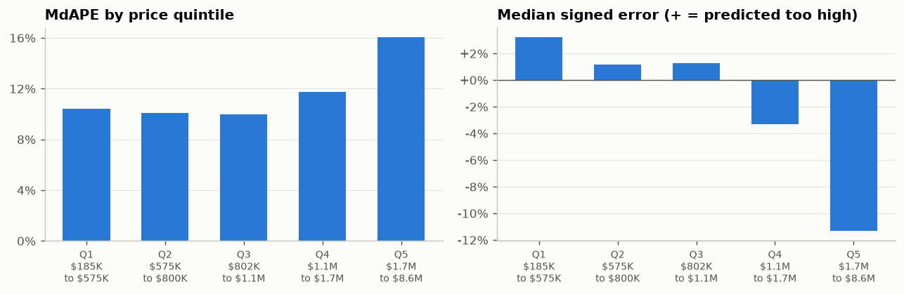
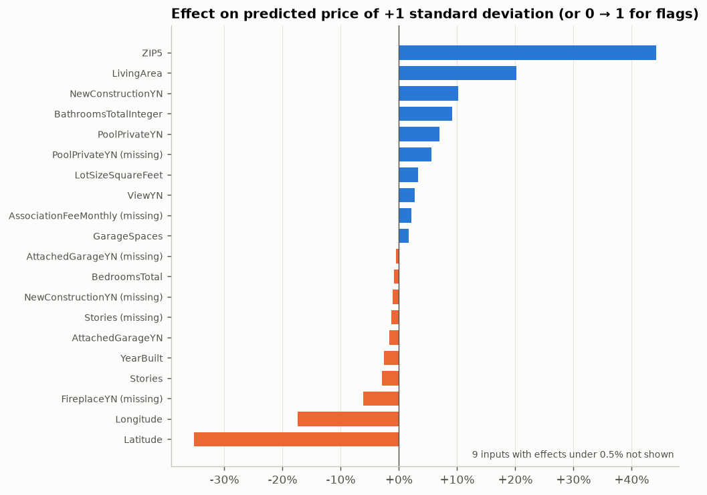

# A Linear Regression Baseline for California Home Prices

**IDX Exchange Data Science Internship, Week 4 memo**
Author: Orcun Tasdemir · October 2026 · Source notebook: [`notebooks/03_baseline_model.ipynb`](../notebooks/03_baseline_model.ipynb) · Code: [`src/modeling.py`](../src/modeling.py)

*Notebooks and memos are numbered by project step, starting with 01 in Week 2, so the Week 4 files carry the number 03 and the Week 3 files the number 02.*

## Purpose

The project's goal is a model that predicts the final sale price of a California single-family home from facts known before the sale. Week 4 builds the first such model, a linear regression, and records how accurate it is. This first model is called the *baseline*: the internship's best-practices document (IDX Exchange's written standard for building price-prediction models) requires every later, more complex model to beat it by a margin clearly larger than chance variation. A baseline that is measured carefully therefore sets the bar for the rest of the project.

## Summary

- **On the test month, April 2026, the baseline predicts half of the homes within 11.4% of their sale price** and explains 82% of the variation in sale prices. On average, a predicted price is off by $207,051 in either direction.
- **Predicting the logarithm of the price works much better than predicting the price itself**: on the month used for choosing settings, half of the homes were predicted within 11.4% of their sale price, against 18.8% when predicting the price itself.
- **The accuracy is stable over time.** At three earlier months spread over 2025, the same half-of-homes figure was between 10.8% and 11.2%.
- **The model fits new months as well as its training months**, so it is limited by what a linear model can express, not by memorizing its training data.
- **Its weakest area is expensive homes.** For the most expensive fifth of homes ($1.7 million and up), half of the predictions are off by more than 16.0%, and the typical prediction is 11.3% below the sale price.

## 1. Setup

**Data and splits.** The model uses the cleaned data and the splits from Week 3 (see the [Week 3 memo](02_preprocessing_memo.md)). In brief: 308,862 cleaned single-family sales from January 2024 to April 2026; 17 facts about each home, such as living area, lot size, bedrooms, year built, location and ZIP code; and a split by time in which a model trains on the 12 months before the month it predicts. Two splits are used:
- **For choosing settings:** train on March 2025 to February 2026 (127,358 sales), and measure the error on March 2026 (11,354 sales), the *validation month*.
- **For the final result:** train on April 2025 to March 2026 (128,330 sales), and measure the error on April 2026 (12,268 sales), the *test month*. The test month is used once, after every choice has been made.

Week 3 also removed extreme sales from each split, using price cutoffs computed from the training months only. The notebook rebuilds both splits from the cleaned data and checks that their row counts and these cutoffs equal the ones saved in Week 3.

**Measures of accuracy.** For each home, the *percentage error* is |predicted price − sale price| / sale price. Four measures summarize a month:

| Measure | Definition |
|---|---|
| MdAPE | the median of the percentage errors; the headline measure, because a few very large errors barely move it |
| MAPE | the mean of the percentage errors |
| R² | the share of the variation in sale prices (in dollars) that the predictions explain; 1 means perfect predictions |
| MAE | the mean of the absolute errors in dollars |

## 2. The model, and its one choice

The model is ordinary least-squares linear regression. It receives the 65 numeric columns that the Week 3 preprocessor builds from the 17 facts: the numeric facts, standardized; 0/1 markers for missing values; one 0/1 column per county, equal to 1 for the home's county; and a single number for the home's ZIP code, the average log sale price of training homes in that ZIP code. That ZIP-code average uses training months only and is computed so that a home's own price never contributes to its own value. The preprocessor and the regression are combined into one object, so that fitting it on training rows fits both, and predicting on new rows applies both using statistics from the training rows only.

A linear regression has no settings to tune, but there is one choice: whether it predicts the sale price itself or the logarithm of the sale price, which is then converted back to dollars by exponentiating. Week 2 argued for the logarithm, because prices are strongly right-skewed and errors in real estate are naturally measured in percent. Both versions were compared on the validation month:

| The model predicts | R² | MAPE | MdAPE | MAE | Negative predicted prices |
|---|---:|---:|---:|---:|---:|
| price | 0.779 | 26.02% | 18.79% | $266,406 | 138 |
| log price | 0.823 | 15.00% | 11.40% | $199,256 | 0 |

The log version is better on all four measures, by the widest margin on the percentage measures. A least-squares fit in dollars concentrates on the expensive homes, whose dollar errors are largest, and so makes large percentage errors on cheaper homes; for 138 homes it even predicts a negative price. **The baseline therefore predicts log price.**

## 3. The result on the test month

The baseline was trained on the final training months and evaluated once on April 2026. For comparison, the first row gives the same measures computed on the 128,330 training homes the model was fit on:

| | R² | MAPE | MdAPE | MAE |
|---|---:|---:|---:|---:|
| Training months (April 2025 to March 2026) | 0.835 | 14.79% | 11.16% | $192,268 |
| **Test month (April 2026)** | **0.820** | **15.17%** | **11.38%** | **$207,051** |

Of the 12,268 test homes, 23.6% are predicted within 5% of their sale price, 44.7% within 10% and 74.5% within 20%.

**The model does not overfit.** A model *overfits* when it learns details of its particular training homes that do not carry over to other homes; its error is then much lower on the training months than on new months. Here the two MdAPE values differ by only 0.22 percentage points, far less than the errors themselves, so memorizing training homes is not what limits the baseline. Its remaining error has two possible sources: patterns that the 17 facts contain but a linear model cannot express, and price differences that the 17 facts cannot explain at all. More flexible models can reduce only the first.

## 4. Stability over time

A single test month could be unusually easy or hard. As the best-practices document recommends, the same procedure was repeated with earlier months in the role of the test month: for each month below, the model was trained on the 12 months before it and evaluated on that month. The earlier months are April, July and October 2025, which cover spring, summer and autumn. Winter months are absent because January to March 2026 were already used in Week 3 to choose the 12-month training window, and using them again would make this check less independent.

| Evaluated month | Training months | R² | MAPE | MdAPE | MAE |
|---|---|---:|---:|---:|---:|
| April 2025 | April 2024 to March 2025 | 0.845 | 14.45% | 10.83% | $193,771 |
| July 2025 | July 2024 to June 2025 | 0.846 | 14.67% | 11.00% | $189,017 |
| October 2025 | October 2024 to September 2025 | 0.843 | 14.97% | 11.16% | $189,405 |
| April 2026 (test month) | April 2025 to March 2026 | 0.820 | 15.17% | 11.38% | $207,051 |

MdAPE stays within a range of 0.55 percentage points (10.83% to 11.38%). The test month is the hardest of the four on every measure; the gap is largest in R², which drops from about 0.845 to 0.820, and in MAE, which rises from about $190,000 to $207,051. This range is a useful yardstick for later models: an improvement much smaller than about half a percentage point of MdAPE would be hard to tell apart from the difference between one month and another.

## 5. Where the errors are

The left panel plots each test home's predicted price against its sale price, both on logarithmic scales; a perfect model would put every home on the diagonal line. The right panel shows the *signed* percentage error, (predicted − actual) / actual, which is positive when the model predicts too high. Its median is −1.3%: the model is nearly centered, with a slight tendency to predict too low.

**By price band.** The test homes were divided into five groups of nearly equal size by sale price, from the cheapest fifth (Q1) to the most expensive fifth (Q5); the sizes differ slightly because homes with the same price at a group boundary are kept together. The "Sale prices" column gives the lowest and highest price in each group:

| Price band | Sale prices | Homes | MdAPE | MAPE | Median signed error |
|---|---|---:|---:|---:|---:|
| Q1 | $185K to $575K | 2,481 | 10.40% | 15.95% | +3.23% |
| Q2 | $575K to $800K | 2,481 | 10.05% | 13.19% | +1.18% |
| Q3 | $802K to $1.1M | 2,403 | 9.97% | 13.07% | +1.25% |
| Q4 | $1.1M to $1.7M | 2,449 | 11.74% | 14.86% | −3.33% |
| Q5 | $1.7M to $8.6M | 2,454 | 16.03% | 18.76% | −11.34% |

The three cheapest bands have a median error of about 10%, rising to 11.7% in Q4. The most expensive band is clearly worse, at 16.0%, and it is predicted too low by a median of 11.3%, while the cheapest band is predicted slightly too high. In other words, the predictions are pulled toward the middle of the price range. A likely reason: a linear model on log price adds up a separate effect for each input, so it cannot express that some combinations, such as a large house in an expensive ZIP code, are worth more than the sum of their parts. Week 5 can test this explanation, since tree models can express such combinations; if they gain the most in Q5, the explanation is supported.

**By county.** For the 10 counties with the most test-month sales:

| County | Homes | MdAPE | Median signed error |
|---|---:|---:|---:|
| Los Angeles | 3,011 | 12.09% | −1.25% |
| Riverside | 1,881 | 11.27% | +0.10% |
| San Diego | 1,439 | 11.93% | −2.31% |
| San Bernardino | 1,225 | 9.75% | +0.46% |
| Orange | 1,166 | 11.21% | −2.65% |
| Alameda | 591 | 12.78% | −3.94% |
| Contra Costa | 584 | 10.83% | −1.39% |
| Ventura | 419 | 11.29% | −1.91% |
| Santa Clara | 392 | 12.61% | −2.87% |
| San Luis Obispo | 215 | 12.69% | −1.01% |

MdAPE ranges from 9.75% in San Bernardino to 12.78% in Alameda. Most of these counties are predicted too low on balance. The largest shortfalls are in Alameda and Santa Clara (−3.94% and −2.87%), two high-priced Bay Area counties (Week 2 median prices of $1.30M and $1.90M), followed closely by Orange (−2.65%, median $1.38M) and San Diego (−2.31%). High-priced counties being predicted too low matches the price-band finding.

## 6. What the model learned

Each input to the regression was standardized (shifted and scaled to mean 0 and standard deviation 1 on the training homes), and the model predicts log price. A coefficient therefore has a direct reading: raising that input by one standard deviation, with all other inputs held fixed, multiplies the predicted price by exp(coefficient). For a 0/1 column, the same holds for switching it from 0 to 1. The chart converts each coefficient into this percentage change, which is what "effect" means below; the 36 county columns and 9 inputs whose effect is under 0.5% in absolute value are omitted. The table lists the seven largest effects in absolute value.

| Input | Effect on predicted price |
|---|---:|
| ZIP-code price level | +44.2% per standard deviation |
| Latitude | −35.2% per standard deviation |
| Living area | +20.2% per standard deviation |
| Longitude | −17.4% per standard deviation |
| Newly built | +10.2% |
| Bathrooms | +9.2% per standard deviation |
| Private pool | +6.9% |

Four observations:
- **Location and size dominate**, as Week 2 expected. The ZIP-code price level has the largest effect overall; among the facts about the house itself, living area has the largest.
- **Newly built homes are predicted 10% higher, other inputs fixed.** In the Week 2 comparison, newly built homes sold for *less* than older ones. The two findings agree once location is taken into account: new homes are mostly built in cheaper areas, and the model's ZIP-code input absorbs that difference, leaving the premium for being new.
- **Latitude and longitude have large negative coefficients.** Once the ZIP code sets the local price level, these two inputs act as broad corrections across the state. Their size should not be read as "homes further north are cheaper"; inputs that carry overlapping information, here ZIP code and coordinates, can take large coefficients that partly cancel.
- **Bedrooms have a small negative effect** (−0.8% per standard deviation). With living area held fixed, more bedrooms means smaller rooms, which may explain why the effect is not positive. Bedrooms, bathrooms and living area are strongly correlated (Week 2), so their individual coefficients should be interpreted with the same caution as latitude and longitude.

## 7. The bar for later models

| Measure on the test month | Baseline |
|---|---:|
| R² | 0.820 |
| MAPE | 15.17% |
| **MdAPE** | **11.38%** |
| MAE | $207,051 |

Week 5 trains a decision tree and a random forest on the same splits, choosing their settings on the validation month, and compares them with these numbers. Two things to look for:
1. **The size of the improvement.** Given the 0.55-point MdAPE range across months in Section 4, a convincing improvement should be well beyond half a percentage point, and should hold at the earlier months too.
2. **Where it comes from.** The baseline's clearest weakness is the expensive end of the market, where it predicts too low. Tree models can represent combinations of inputs, so this is where they are expected to gain the most.

## Outputs and reproducing

- `results/03_baseline_metrics.csv` holds the baseline's measures for the validation month, the three earlier months and the test month. It contains only scores and is committed, so later notebooks read the baseline from it.
- The four charts are in `reports/figures/` (files starting with `03_`).
- To rerun: run `02_preprocessing.ipynb` once to create the cleaned data (it stays on the local machine), then `python scripts/run_notebooks.py 03`. The run takes under a minute, and rerunning it reproduces the same notebook and results exactly.
