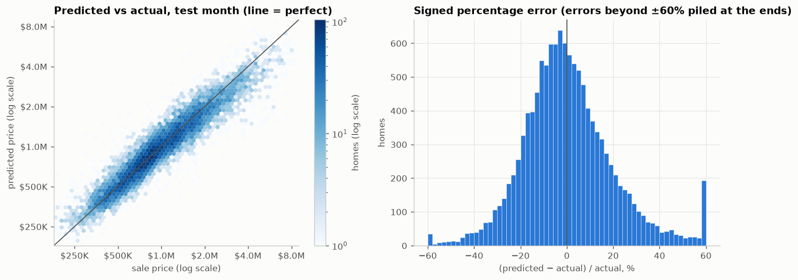
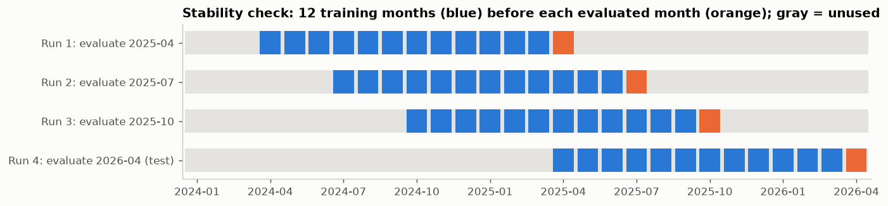
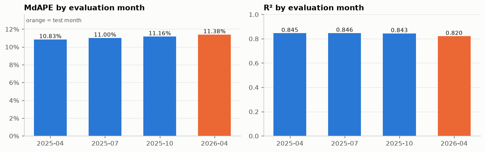
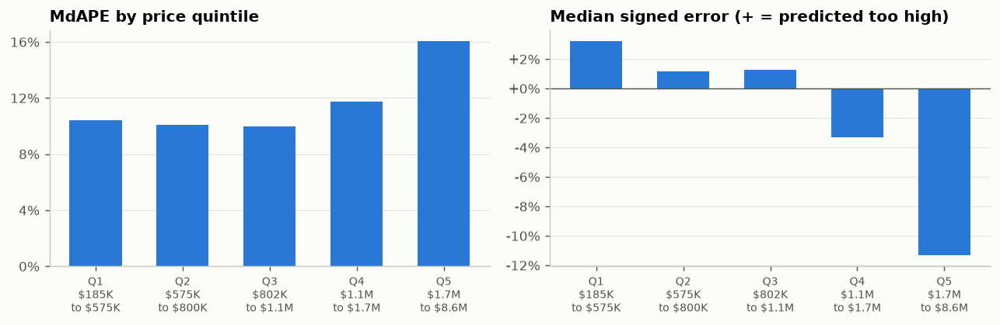
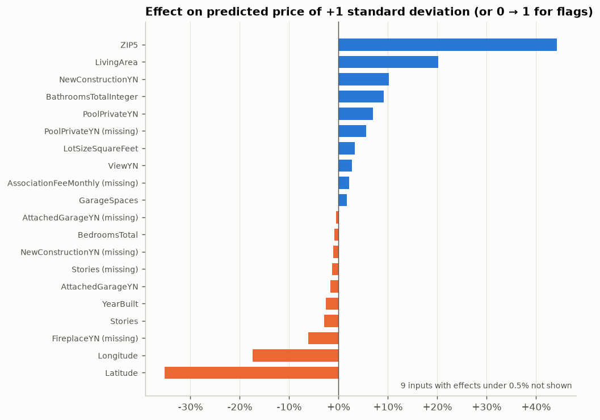
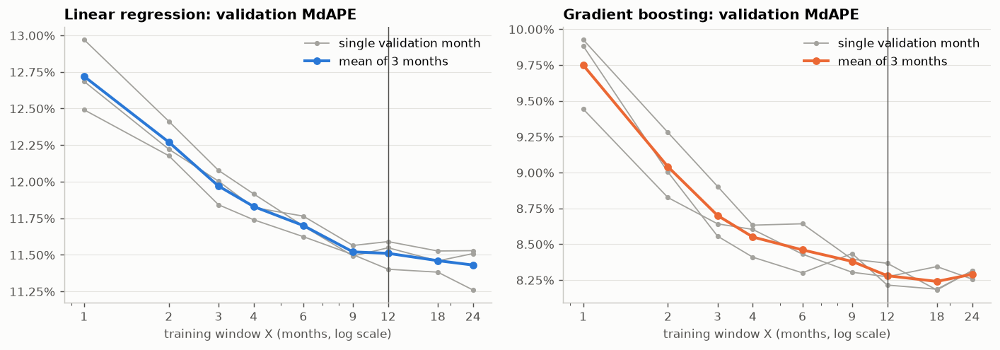

# Week 4 Meeting Memo: The Linear Regression Baseline

**IDX Exchange Data Science Internship** · Orcun Tasdemir · October 2026
Detailed write-up: [`03_baseline_memo.md`](03_baseline_memo.md) · Notebook: [`notebooks/03_baseline_model.ipynb`](../notebooks/03_baseline_model.ipynb)

## In one paragraph

This week I built the first model for predicting the sale price of California single-family homes: a linear regression. It was trained on 12 months of sales (April 2025 to March 2026) and tested once on the following month, April 2026. On that month it predicts half of the homes within 11.4% of their actual sale price and explains 82% of the variation in prices (these two measures, MdAPE and R², are defined in Section 4). Repeating the same procedure at three earlier months gives almost the same accuracy, so the result is stable. The model's clearest weakness is expensive homes, which it prices too low. This model is the *baseline*: every model in the coming weeks must beat it by a clear margin.

## 1. Why a baseline first

The internship's best-practices document (IDX Exchange's standard for building price-prediction models) requires starting with a simple linear regression and then showing that more complex models, such as decision trees, random forests and gradient boosting, improve on it by more than chance variation. The baseline is therefore a measuring stick. What matters most this week is that it is measured honestly, so that later comparisons mean something.

## 2. Which months are used for what

The cleaned data covers **28 months of sales, January 2024 to April 2026**, a total of 308,862 single-family sales. Every model follows one rule: to predict a month, it is trained on the **12 months immediately before that month**, and it never sees the month it is scored on. The 12-month window was chosen by experiment in Week 3.

The months play three roles:

| Role | Month(s) | What it is used for |
|---|---|---|
| **Training months of the final model** | April 2025 to March 2026 (128,330 sales) | fitting the model that is reported |
| **Validation month** | March 2026 | making choices, such as log price versus price (Section 3) |
| **Test month** | April 2026 (12,268 sales) | the final score, measured once after all choices are made |

March 2026 appears in two roles, one after the other. To make a choice, a model is trained on the 12 months before March (March 2025 to February 2026) and scored on March. Once all choices are made, the final model is trained on the 12 months before April, which now include March, and scored on April. The test month is kept out of every decision; if choices were made by looking at it, its score would no longer be an honest estimate of how the model does on new data.

## 3. The model and its one choice

The model is ordinary linear regression. It receives 17 facts about each home: living area, lot size, bedrooms, bathrooms, year built, garage spaces, stories, monthly homeowners-association fee, latitude, longitude, five yes/no facts (private pool, view, attached garage, fireplace, newly built), the county and the ZIP code. Week 3 turned these into 65 numeric columns: the numbers rescaled to a common scale, 0/1 markers for missing values, one 0/1 column per county (1 for the home's own county), and one number for the ZIP code, namely the average log sale price of training homes in that ZIP code, computed from training months only and without using the home's own price.

A linear regression has no settings to tune, but one choice remains: **predict the sale price itself, or the logarithm of the price** (converted back to dollars afterwards). On the validation month:

| The model predicts | Half of homes within | R² | Negative predicted prices |
|---|---:|---:|---:|
| price in dollars | 18.8% | 0.779 | 138 |
| **logarithm of price** | **11.4%** | **0.823** | **0** |

The logarithm wins clearly. A fit in dollars is dominated by expensive homes, whose dollar errors are largest, so it makes large percentage errors on cheaper homes and even predicts negative prices. With the logarithm, the model's errors and effects become percentages ("a pool adds about 7%"), which is how home prices behave and how accuracy is judged in real estate.

## 4. The result on the test month

Four measures are reported. Each starts from a home's *percentage error*, |predicted price − sale price| / sale price.

| Measure | Meaning | On its own training homes | **Test month** |
|---|---|---:|---:|
| MdAPE | median percentage error: half of homes are predicted within this | 11.16% | **11.38%** |
| MAPE | mean percentage error; higher because a few homes have large misses | 14.79% | **15.17%** |
| R² | share of the variation in prices (in dollars) that the model explains | 0.835 | **0.820** |
| MAE | mean error in dollars, in either direction | $192,268 | **$207,051** |

The middle column scores the final model on the 128,330 homes it was trained on; the last column on the 12,268 test homes it never saw.

In the left chart, each test home is placed by its sale price (across) and its predicted price (up), both on logarithmic scales; a perfect model would put every home on the diagonal line. The right chart shows the signed percentage error, (predicted − actual) / actual, which is positive when the model predicts too high. Its median is −1.3%, so the model is nearly centered. On the test month, **23.6% of homes are predicted within 5%, 44.7% within 10% and 74.5% within 20%** of their sale price. MdAPE is the headline measure: a few homes with very large errors barely move it, whereas they strongly affect R² and MAE.

**The model does not overfit.** A model that memorizes details of its training homes would score much better on them than on new homes. Here the two MdAPE values differ by only 0.22 percentage points, so memorization is not what limits the model. Its remaining errors come from patterns a linear model cannot express, which flexible models can address, and from price differences that the 17 facts cannot explain at all.

## 5. Is the result stable over time?

A single test month could happen to be easy or hard. To check, the whole procedure was repeated three more times, with an earlier month playing the role of the test month: a fresh model trained on the 12 months before it, then scored on that month. The chart shows which months each run used: blue for the 12 training months, orange for the evaluated month, gray for months not used by that run.

| Run | Trained on | Evaluated on | MdAPE | MAPE | R² | MAE |
|---|---|---|---:|---:|---:|---:|
| 1 | April 2024 to March 2025 | April 2025 | 10.83% | 14.45% | 0.845 | $193,771 |
| 2 | July 2024 to June 2025 | July 2025 | 11.00% | 14.67% | 0.846 | $189,017 |
| 3 | October 2024 to September 2025 | October 2025 | 11.16% | 14.97% | 0.843 | $189,405 |
| 4 | April 2025 to March 2026 | **April 2026 (test)** | 11.38% | 15.17% | 0.820 | $207,051 |

The evaluated months are spaced three months apart, in step with April, the test month, so they cover spring, summer and autumn. No winter month is included. January 2025 would be a valid fifth check and can be added; January to March 2026 are not good candidates, because they were already used in Week 3 to choose the 12-month window, and scoring them again would flatter the model.

**Reading the result.** The median error stays between 10.83% and 11.38%, a range of 0.55 percentage points, and R² between 0.82 and 0.85. Had any of these months been the test month, the conclusion would have been the same. The range also gives a yardstick for next week: an improvement much smaller than about half a percentage point could be ordinary month-to-month variation.

**Two caveats.** First, the error rises slightly from run to run (10.83%, 11.00%, 11.16%, 11.38%), and the test month is the hardest of the four on every measure; four runs are too few to tell a trend from chance, so later models should be checked the same way. Second, the training windows overlap: runs 1 and 2, and runs 2 and 3, share 9 of their 12 training months, and runs 3 and 4 share 6. The four runs are therefore a consistency check, not four independent experiments.

## 6. Side check: squared versus absolute loss

Ordinary linear regression minimizes the sum of *squared* errors, which gives large errors a heavy weight. A natural question is whether minimizing the sum of *absolute* errors instead (called median regression) would serve as well as, or better than, taking the logarithm. I tested all four combinations on the March 2026 validation month. The column "Expensive fifth: typical error" is the median of (predicted − actual) / actual over the most expensive fifth of validation homes; a negative value means those homes are priced too low.

| Linear model | Half of homes within | MAPE | R² | Negative prices | Expensive fifth: typical error | Fit time |
|---|---:|---:|---:|---:|---:|---:|
| squared loss, dollars | 18.79% | 26.02% | 0.779 | 138 | −6.1% | 1 second |
| absolute loss, dollars | 13.87% | 18.76% | 0.732 | 13 | −16.5% | about 10 minutes |
| **squared loss, log price (the baseline)** | **11.40%** | **15.00%** | **0.823** | **0** | **−11.2%** | **under 1 second** |
| absolute loss, log price | 11.10% | 14.77% | 0.812 | 0 | −12.4% | about 10 minutes |

- **Absolute loss in dollars helps, but it is not enough.** It lowers the median error from 18.8% to 13.9%, but it still treats a $50,000 miss on a $200,000 home like one on a $3 million home, still predicts some negative prices, and prices expensive homes the lowest of all four.
- **The logarithm is the larger improvement**, because it makes the model work in percentages, which absolute loss alone does not do.
- **Absolute loss on log price is slightly better on the percentage measures** (11.10% against 11.40%). The gain of 0.3 points is smaller than the 0.55-point month-to-month range from Section 5 and was measured on one month only. It is also slightly worse on R², prices expensive homes slightly lower, and takes about 10 minutes to fit instead of under a second.

**Decision: the baseline stays ordinary linear regression on log price.** It is the standard model the task asks for, it is fast, and the alternative's gain is within noise. The numbers are saved in `results/03_loss_comparison.csv`.

## 7. Where the model goes wrong

The test homes were split into five groups of nearly equal size by sale price, from the cheapest fifth (Q1) to the most expensive fifth (Q5). Each range runs from the lowest to the highest sale price within the group, so the small gaps between ranges (such as $800K to $802K) contain no homes. The typical error is defined as in Section 6, now on the test month:

| Price band | Sale prices | Half of homes within | Typical error (+ = too high) |
|---|---|---:|---:|
| Q1 | $185K to $575K | 10.40% | +3.2% |
| Q2 | $575K to $800K | 10.05% | +1.2% |
| Q3 | $802K to $1.1M | 9.97% | +1.2% |
| Q4 | $1.1M to $1.7M | 11.74% | −3.3% |
| Q5 | $1.7M to $8.6M | 16.03% | −11.3% |

**The predictions are pulled toward the middle of the price range.** Cheap homes are priced slightly too high and expensive homes clearly too low, and the expensive fifth has by far the largest errors. A likely reason: a linear model adds up a separate effect for each fact, so it cannot express that a combination, such as a large house in an expensive ZIP code, is worth more than the two effects added. Next week's tree models can express such combinations, so if they improve most on the expensive fifth, that supports this explanation.

**By county**, the median error among the 10 counties with the most sales ranges from 9.75% (San Bernardino) to 12.78% (Alameda). The high-priced counties are priced somewhat too low: the typical error is −3.9% in Alameda, −2.9% in Santa Clara and −2.7% in Orange, against close to zero in Riverside (+0.1%) and San Bernardino (+0.5%). This matches the price-band pattern.

## 8. What the model learned

Each bar is the percentage change in the predicted price when one input rises by one standard deviation (or switches from no to yes), with all other inputs held fixed.

- **Location matters most.** The ZIP-code price level has the largest effect, +44%.
- **Living area is the most important fact about the house itself**, at +20%.
- **Newly built homes get a 10% premium.** In Week 2, newly built homes sold for *less* than older ones (median $645,000 against $895,000) and also had a much lower price per square foot ($308 against $538), which points to their being built mostly in cheaper areas. The two findings are consistent: comparing raw prices mixes the effect of being new with the effect of location, and once the model accounts for the ZIP code, being new adds value.
- **Bedrooms have a slightly negative effect** (−0.8%) when living area is held fixed, since more bedrooms in the same space means smaller rooms.
- **Latitude and longitude show large negative values.** They carry much of the same location information as the ZIP code. When inputs are strongly correlated with each other (called *multicollinearity*), a linear regression can give them large coefficients that partly cancel, so these two should not be read on their own.

## 9. Takeaways and next week

**Takeaways**
1. The baseline predicts half of the homes within **11.4%** of their sale price on the test month, with **R² = 0.820**.
2. Predicting the **logarithm of price** was the key modeling choice; absolute loss did not add a meaningful improvement.
3. The result is **stable**: four months give median errors between 10.8% and 11.4%, and the model does not overfit.
4. The weakness is **expensive homes**, priced about 11% too low.

**Week 5:** a decision tree and a random forest, the first two of the more complex models named in Section 1, trained on the same months, with their settings chosen on the March 2026 validation month. They will be compared with the baseline in one table. To count as a real improvement, they should beat 11.38% by clearly more than half a percentage point, also at the three earlier months.

## 10. Questions that may come up

**Why not use the listing price as an input? It is almost equal to the sale price.**
It is set during the sale process, so it does not exist for homes that are not for sale, and the model must price those too. A model given the listing price would mostly copy it. The best-practices document excludes it.

**Why is MdAPE the headline instead of R²?**
R² is computed in dollars, so a few very expensive homes dominate it. The median percentage error describes the typical home and barely moves because of a few large misses.

**Is 11.4% good?**
For a first, linear model it is a reasonable starting point. It is measured on a month the model never saw, and the same procedure gives similar results at three earlier months. There is clear room to improve: in Week 3, when choosing the training window, a gradient-boosting model with default settings (a tree-based method scheduled for Week 7) was trained the same way, and its median error averaged over the January to March 2026 validation months was about 8.3%, against 11.5% for the linear model in the same comparison.

**How many months is the final model trained on?**
12 months, April 2025 to March 2026, which is 128,330 sales. The 12-month window was chosen in Week 3 by training on windows from 1 to 24 months and averaging the median error over three validation months (January to March 2026). Shorter windows were clearly worse: going from 1 to 12 months lowered the error by more than a percentage point.

**Why not 24 months, to use all the data?**
In the Week 3 comparison, 24 months was not meaningfully better than 12. The chart shows the median error for each window and each of the three validation months (gray), with their average in color; the vertical line marks 12 months.

| Window | Linear regression | Gradient boosting |
|---|---:|---:|
| 12 months | 11.51% | 8.28% |
| 18 months | 11.46% | 8.24% |
| 24 months | 11.43% | 8.29% |

For linear regression, 24 months was 0.08 points better; for gradient boosting it was slightly worse than 12. Both differences are about the size of the variation between validation months (about 0.1 points), so they cannot be told apart from noise. Given a tie, 12 months was preferred for three reasons. The model has no input describing when a sale happened, so a 24-month window would treat spring 2024 prices as current. Twelve months contains each calendar month once, so every season counts equally. And because the data starts in January 2024, a 24-month window could only be evaluated from January 2026 on, which would rule out the stability check of Section 5. The window will be tested again in Week 6, when features describing the time of sale are added, since those make older data more useful.

**Could the results change if the notebook is run again?**
No. The linear regression itself involves no randomness, and the few random steps elsewhere (for example, the random split of training homes used to compute the ZIP-code averages) always start from the same fixed seed, the number 42. Rerunning the notebooks therefore produces exactly the same numbers, charts and files.
