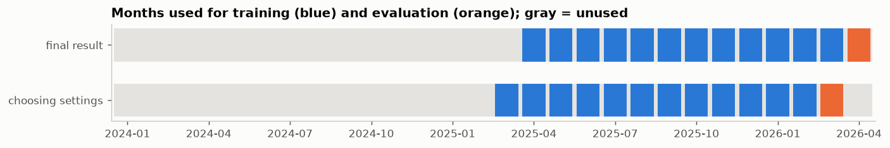
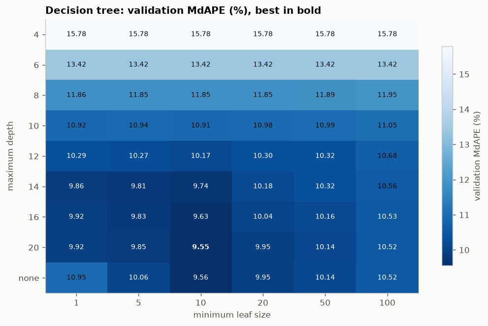
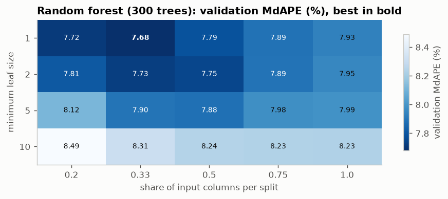
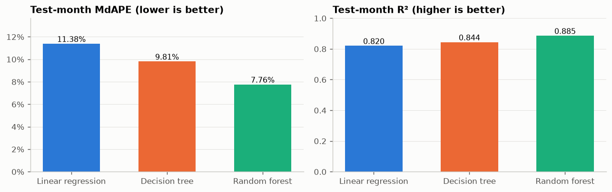
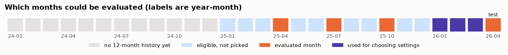
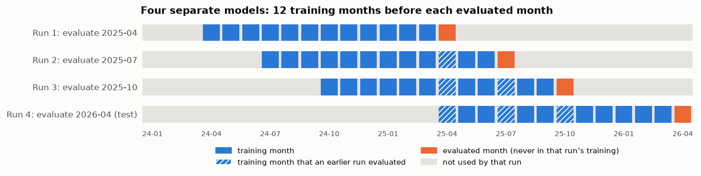
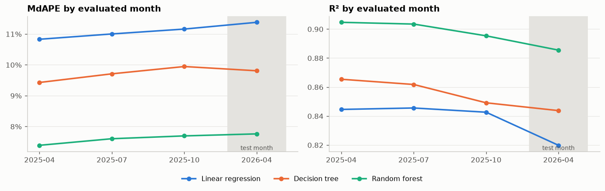
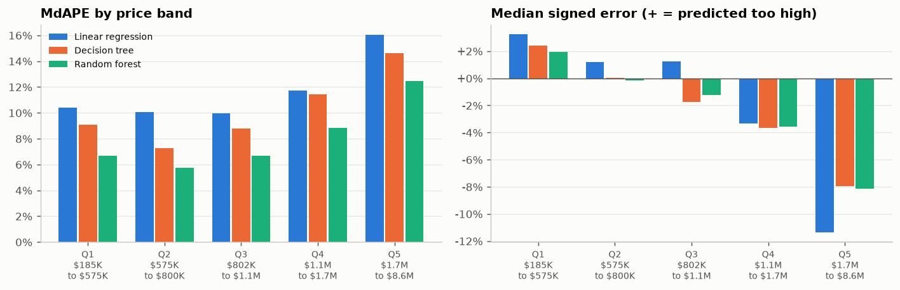
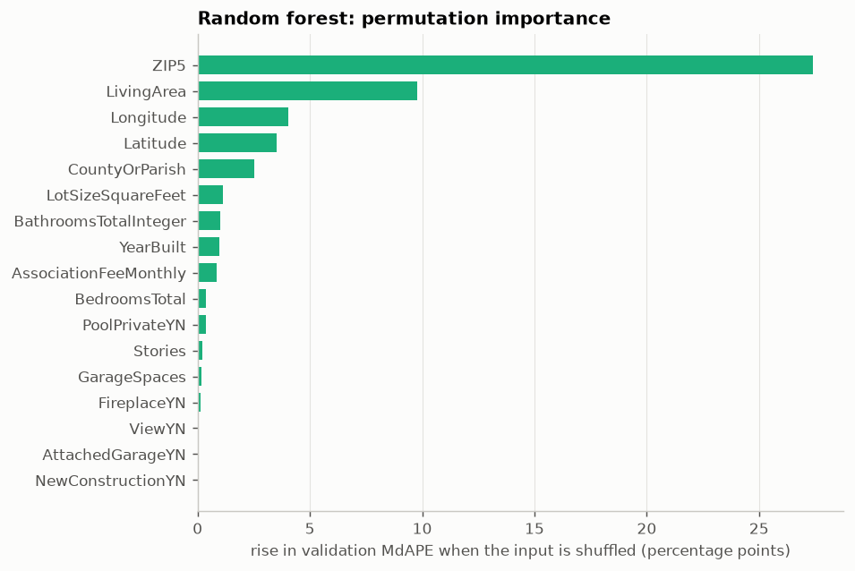

# Week 5 Meeting Memo: Decision Tree and Random Forest

**IDX Exchange Data Science Internship** · Orcun Tasdemir · October 2026
Notebook: [`notebooks/04_model_comparison.ipynb`](../notebooks/04_model_comparison.ipynb) · Previous week: [`03_meeting_memo.md`](03_meeting_memo.md)

*Notebooks and memos are numbered by project step, starting with 01 in Week 2, so the Week 5 files carry the number 04.*

## In one paragraph

This week I trained two tree-based models, a decision tree and a random forest, and compared them with last week's linear regression baseline on exactly the same data, months and inputs. The random forest is the clear winner. On the test month, April 2026, it predicts half of the homes within **7.8%** of their sale price, against **11.4%** for the baseline, and it explains 88.5% of the variation in prices, against 82.0% (both measures are defined in Section 1). The improvement holds at every month I checked and is far larger than chance variation. The forest improves every price range, but expensive homes remain the hardest to predict and are still priced too low.

## 1. What was compared, and how

Three models, all trained the same way:

| Model | Idea |
|---|---|
| **Linear regression** (Week 4 baseline) | adds up one separate effect per input |
| **Decision tree** | asks a sequence of yes/no questions about the inputs and predicts the average price of the training homes that end up in the same final group |
| **Random forest** | trains 300 slightly different decision trees and averages their predictions |

The setup is the same as in Week 4, so the comparison is fair:
- **Same data and inputs:** 308,862 cleaned single-family sales from January 2024 to April 2026, and 17 facts per home: living area, lot size, bedrooms, bathrooms, year built, garage spaces, stories, monthly association fee, latitude, longitude, five yes/no features (pool, view, attached garage, fireplace, newly built), county and ZIP code. Week 3 turned these into model-ready numbers (missing values filled, categories converted to numbers, everything learned from training months only).
- **Same months:** model settings are chosen by training on March 2025 to February 2026 and scoring the *validation month*, March 2026. The final models are trained on the 12 months April 2025 to March 2026 (128,330 sales) and scored once on the *test month*, April 2026 (12,268 sales).
- **Same target:** every model predicts the logarithm of the price. In Week 4, this halved the baseline's typical error compared with predicting dollars directly (11.4% against 18.8% on the validation month).
- **Same measures.** Each starts from a home's percentage error, |predicted price − sale price| / sale price. **MdAPE** is the median of these errors (half of the homes are predicted within it) and is the headline. **MAPE** is their mean. **R²** is the share of the variation in prices that the model explains. **MAE** is the mean error in dollars.

**Keeping choices away from the test month.** Every setting is chosen on one month, and the final score comes from a different month that played no part in any choice:

| Step | Trained on | Scored on | Used for |
|---|---|---|---|
| Choosing settings | March 2025 to February 2026 | **March 2026** (validation month) | picking each model's settings |
| Final result | April 2025 to March 2026 | **April 2026** (test month) | one score per model, after all settings are fixed |

Once the settings are fixed, March 2026 is no longer needed for choosing, so the final models are retrained with March included, using the frozen settings. April 2026 is never seen by any model before its single final score. The outlier cutoffs and everything the preprocessor learns (medians, ZIP-code averages, scaling) also come from the training months only.

## 2. Choosing each model's settings

Unlike linear regression, tree models have settings that control how detailed they get. Each setting was chosen by its error on the validation month; the test month played no part.

**Decision tree.** Two settings: the *maximum depth* (the most yes/no questions on any path through the tree) and the *minimum leaf size* (the fewest training homes allowed in a final group, called a *leaf*). Every combination was tried:

Shallow trees are too coarse: a tree of depth 4 can only predict 16 different prices, and its validation MdAPE is 15.8%. Very deep trees with leaves of a single home memorize the training data. The best tree is in between: **maximum depth 20, minimum leaf size 10**, with a validation MdAPE of 9.55%.

**Random forest.** Each of its trees is trained on a random resample of the training homes, and each split considers only a random share of the inputs, so the trees differ and their errors partly cancel when averaged. Two settings were searched, the share of inputs per split and the minimum leaf size, each forest with 300 trees:

The best forest considers **one third of the inputs per split** and grows trees down to **leaves of a single home**, with a validation MdAPE of 7.68%. The results are fairly flat near the best, so the forest is not sensitive to the exact choice. Going from 300 to 500 trees improved the validation MdAPE by only 0.03 points, so 300 trees were kept.

## 3. The result on the test month

| Model | R² | MAPE | MdAPE | MAE |
|---|---:|---:|---:|---:|
| Linear regression (baseline) | 0.820 | 15.17% | 11.38% | $207,051 |
| Decision tree | 0.844 | 14.19% | 9.81% | $194,300 |
| **Random forest** | **0.885** | **11.42%** | **7.76%** | **$159,355** |

Another way to read the same result is the share of test homes predicted within a given percentage of their sale price:

| Model | Within 5% | Within 10% | Within 20% |
|---|---:|---:|---:|
| Linear regression | 23.6% | 44.7% | 74.5% |
| Decision tree | 28.3% | 50.7% | 77.5% |
| **Random forest** | **35.1%** | **59.8%** | **84.0%** |

The forest is best on every measure. Its typical error is about a third lower than the baseline's (7.76% against 11.38%), and its average dollar error is about $48,000 lower.

## 4. Is the improvement real?

The internship's best-practices document (IDX Exchange's written standard for building price-prediction models) requires that a more complex model beat the baseline by a margin that is clearly not chance. Two checks:

**Check 1: the same comparison at earlier months.** As in Week 4, each model was retrained on the 12 months before April, July and October 2025 and scored on that month.

*How these months were chosen.* A month can be evaluated only if it has 12 months of history before it (the data starts in January 2024, so the earliest is January 2025) and was not used for any decision (January to March 2026 were the validation months for choosing the 12-month window in Week 3, and March 2026 is where all settings are chosen). That leaves January to December 2025 as clean candidates. One month per quarter was picked in advance, three months apart in step with the April test month, without trying other sets:

*Each evaluated month gets its own model.* There is not one model scored on four months but four separate models, each trained from scratch on the 12 months before its evaluated month. Within each run, the evaluated month, and everything after it, is excluded from training. A month evaluated in an early run can still be a training month in a later run (hatched below): April 2025 is evaluated in run 1 and used for training in runs 2, 3 and 4. That is a different model, scored on a later month, so no model is ever scored on a month it trained on.

| Run | Trained on (12 months) | Evaluated on | Evaluated month in its own training? |
|---|---|---|---|
| 1 | April 2024 to March 2025 | April 2025 | no |
| 2 | July 2024 to June 2025 | July 2025 | no |
| 3 | October 2024 to September 2025 | October 2025 | no |
| 4 (final) | April 2025 to March 2026 | April 2026 (test) | no |

*Two limitations of this check.* First, no winter month is included; January 2025 was eligible but not picked, and January is the slowest month for sales. Second, runs 1 to 3 use the settings chosen on March 2026, a month that comes after them; strictly, each earlier run would re-choose its settings on its own preceding month. Neither affects the April 2026 test result. From Week 6 on, the check will use all twelve months of 2025, which covers every season.

The results of the four runs:

The table gives the MdAPE values from the left chart:

| Evaluated month | Linear regression | Decision tree | Random forest |
|---|---:|---:|---:|
| April 2025 | 10.83% | 9.43% | 7.39% |
| July 2025 | 11.00% | 9.71% | 7.60% |
| October 2025 | 11.16% | 9.94% | 7.69% |
| **April 2026 (test)** | **11.38%** | **9.81%** | **7.76%** |

The ranking is the same at every month, and the forest is 3.4 to 3.6 points below the baseline each time. The baseline's own MdAPE varies by only 0.55 points across these four months (10.83% to 11.38%; Week 4 ran the same check), so a gain of more than 3 points is about six times that month-to-month range.

**Check 2: could the test-month gain be luck in which homes sold?** The test month is one sample of 12,268 homes; had a somewhat different set of homes sold, the difference between two models would come out a little differently. To estimate how much, a new set of 12,268 homes was drawn at random from the test homes, with replacement (so some homes appear twice and others not at all), both models were scored on it, and the difference in MdAPE was recorded. This was repeated 2,000 times. The middle 95% of the 2,000 differences is a *95% range*: the difference is very likely to fall inside it if the same comparison were made on other homes like these. If the range stays well away from zero, the better model's advantage is not luck.

| Comparison | MdAPE difference | 95% range |
|---|---:|---:|
| Linear regression minus random forest | 3.62 points | 3.37 to 3.88 |
| Linear regression minus decision tree | 1.57 points | 1.27 to 1.85 |
| Decision tree minus random forest | 2.05 points | 1.82 to 2.31 |

None of the ranges comes near zero, so each model is genuinely better than the one before it.

## 5. Where the improvement comes from

Last week's finding was that the baseline prices expensive homes too low, and I suggested a reason: a linear model adds up separate effects, so it cannot express that a combination, such as a large house in an expensive ZIP code, is worth more than its parts. Tree models can express such combinations, so the prediction was that they would gain the most on expensive homes. The test homes were split into five groups of nearly equal size by sale price (Q1 cheapest to Q5 most expensive):

In the table, the "typical error" is the median of (predicted − actual) / actual within the band; negative means priced too low.

| Price band | Sale prices | Baseline MdAPE | Forest MdAPE | Error reduced by | Baseline typical error | Forest typical error |
|---|---|---:|---:|---:|---:|---:|
| Q1 | $185K to $575K | 10.40% | 6.69% | 36% | +3.2% | +2.0% |
| Q2 | $575K to $800K | 10.05% | 5.76% | 43% | +1.2% | −0.2% |
| Q3 | $802K to $1.1M | 9.97% | 6.67% | 33% | +1.2% | −1.3% |
| Q4 | $1.1M to $1.7M | 11.74% | 8.83% | 25% | −3.3% | −3.6% |
| Q5 | $1.7M to $8.6M | 16.03% | 12.45% | 22% | −11.3% | −8.2% |

**The prediction was only partly right.** The forest helps every band. The expensive band's underpricing shrinks from −11.3% to −8.2%, but in relative terms the mid-priced homes gain the most (43% lower error in Q2) and the expensive homes the least (22% in Q5). One reason the top stays hard: a tree's prediction is an average of training prices, so it can never exceed the highest training price, and averaging 300 trees pulls extreme predictions further toward the middle. The forest's highest test-month prediction is $6.8 million, while the most expensive training sale is $8.6 million. (The same $8.6 million also caps the test month, because Week 3's outlier cutoff, computed from the training months, removes sales above it in both.)

## 6. What the forest relies on

A forest has no coefficients to read. Instead, each input's values were shuffled at random across the validation homes, which breaks that input's link with price, and the rise in the forest's error was measured. The bigger the rise, the more the forest depends on that input.

- **ZIP code dominates:** shuffling it raises the forest's validation MdAPE by 27.4 percentage points (from 7.7% to about 35%).
- **Living area** is next, at 9.8 points, then longitude (4.0), latitude (3.5) and county (2.5).
- **The yes/no features** (pool, view, fireplace, attached garage, newly built) barely matter once location and size are known.

This agrees with the baseline from Week 4, whose two largest effects were also location and size: +44% per standard deviation of the ZIP-code price level and +20% per standard deviation of living area.

## 7. Strengths and weaknesses of each model

| | Linear regression | Decision tree | Random forest |
|---|---|---|---|
| **Accuracy (test MdAPE)** | 11.38%, the weakest | 9.81% | **7.76%, the best** |
| **Overfitting** (MdAPE on training homes vs test) | none: 11.16% vs 11.38% | clear: 7.39% vs 9.81% | very large gap, 3.34% vs 7.76%, yet still the best on new homes |
| **Combinations of inputs** | cannot express them | can, through successive questions | can, and averages away much of a single tree's noise |
| **Shape of predictions** | smooth | steps: one price per leaf (9,081 leaves) | near-smooth average of many steps |
| **Highest prices** (highest test prediction vs highest training price) | 0.98 | 0.90; cannot exceed training prices | 0.79; cannot exceed them, and averaging pulls extremes in |
| **Interpretation** | each coefficient is a percentage effect | the first few questions can be read directly | needs indirect tools such as shuffling inputs |
| **Training time and size** | under 1 second; tiny | about 1 second; small | about 6 seconds on 24 cores; 47.9 million tree nodes (a node is one question or one leaf) |

**On the forest's overfitting gap.** Each of its trees memorizes its own resample of the training homes, which is why the forest fits its training homes so closely. That is expected and harmless here: what counts is the error on homes the model has not seen, and there the forest is clearly best.

## 8. Takeaways and next week

**Takeaways**
1. **The random forest is the new best model:** test-month MdAPE 7.76% and R² 0.885, against 11.38% and 0.820 for the baseline.
2. **The gain is real:** 3.4 to 3.6 points at all four months, and a 95% range of 3.4 to 3.9 points on the test month.
3. **Every price range improves,** but **expensive homes remain the weak spot,** still priced about 8% too low.
4. **Location and size drive the predictions;** the yes/no features add little.

**Week 6: feature engineering.** I'll add new inputs built from the existing data (age of the home at the time of sale instead of only the year built, bedroom-to-bathroom ratio, month of sale) and school districts from the state's school-district map, retrain all three models, and compare the old and new input sets in one table. I'll also recheck the 12-month training window: today the models cannot tell an older sale from a recent one, so older months add stale prices; once the month and season of sale are inputs, a longer window may help.

## 9. Questions that may come up

**Why is the random forest so much better than a single tree?**
A single deep tree reacts strongly to the particular homes it was trained on: change a few training homes and its questions change. The forest trains 300 trees on different random resamples, and averaging them cancels much of that sensitivity while keeping their ability to capture combinations of inputs.

**The forest fits its training homes far better than the test month. Isn't that overfitting?**
It fits its training homes very closely, but that is not a problem in itself. What matters is accuracy on new homes, and there the forest is best at all four months. The single tree, by contrast, overfits in a harmful way: its settings had to be limited to keep it from getting worse on new homes.

**Were the settings chosen by looking at the test month?**
No. Every setting was chosen on the March 2026 validation month, and each final model was scored on April 2026 once.

**Why not use more trees? Is there a rule for that choice?**
Going from 300 to 500 trees improved the validation MdAPE by 0.03 points. A standard rule for such choices is the *one-standard-error rule*: take the simplest setting whose validation error is within one standard error of the best one, because smaller differences are within the measurement's own noise. Redrawing the validation homes at random gives a standard error of about 0.09 points for the forest's MdAPE, so anything from 100 to 500 trees is a statistical tie. More trees cannot make a forest overfit, though; they only make its average more stable, so the number of trees is a trade-off between training time and a shrinking gain, and 300 is a reasonable point where the gains have flattened. For the decision tree, where depth and leaf size do control overfitting, the same rule would pick a slightly smaller tree (depth 16 instead of 20, validation MdAPE 9.63% against 9.55%), which is statistically tied with the chosen one. From Week 6 on, the one-standard-error rule will be the written-down way of choosing settings.

**Were the evaluated months excluded from training?**
Yes, within each run. Each evaluated month has its own model, trained only on the 12 months before it. A month evaluated in an early run can be training data for a later run, but that is a different model scored on a later month.

**Is 7.8% good?**
It is a large step from the baseline: 60% of test homes are now predicted within 10% of their sale price, against 45% before. The remaining weak spot is the most expensive fifth of homes, which is where Week 6's new inputs can be tested, and Week 7's gradient boosting, another way of combining many trees in which each new tree is built to correct the errors of the trees before it.

**Could the results change if the notebook is run again?**
No. The random parts of the forest (the resamples and the inputs considered at each split) all start from the same fixed seed, the number 42. Running the notebook twice gives identical results.
