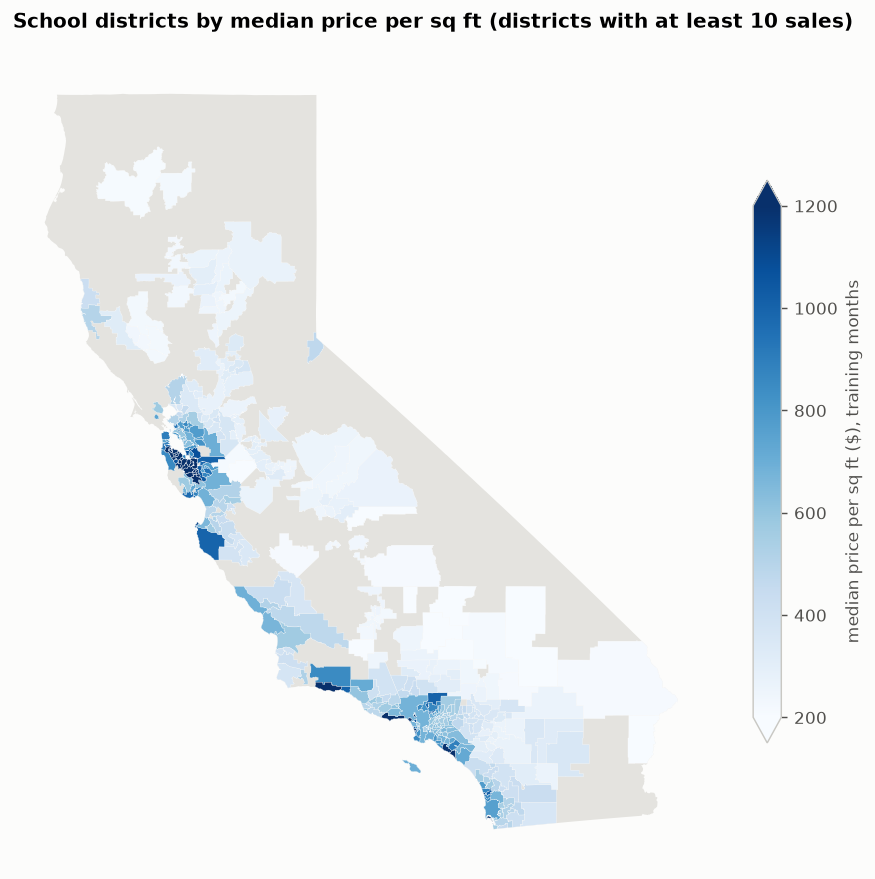
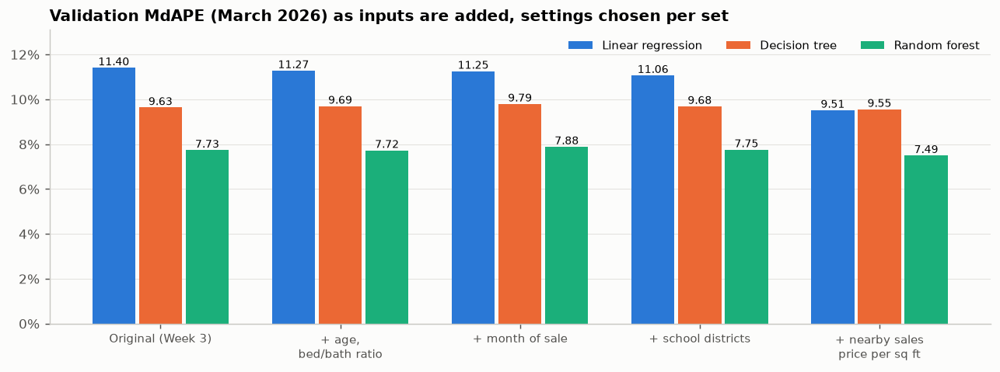
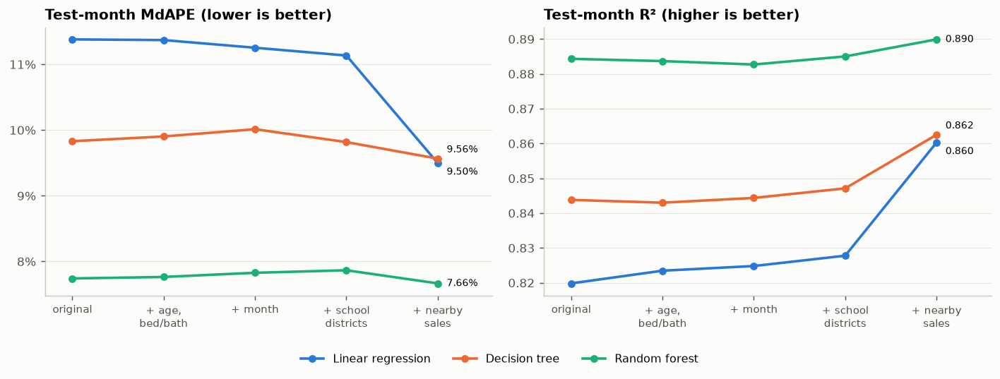
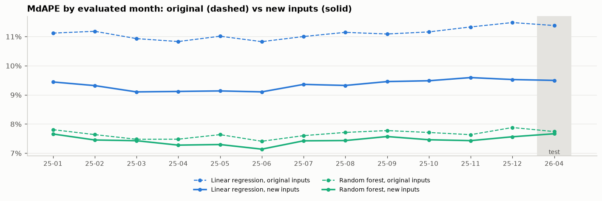
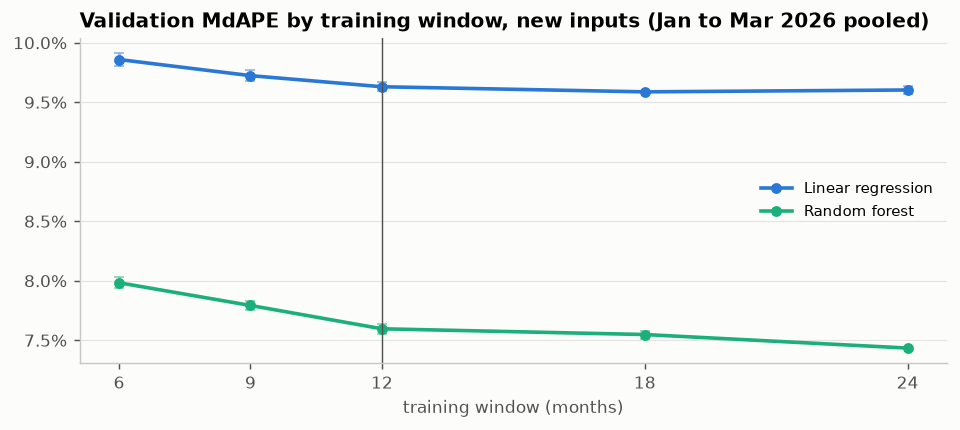
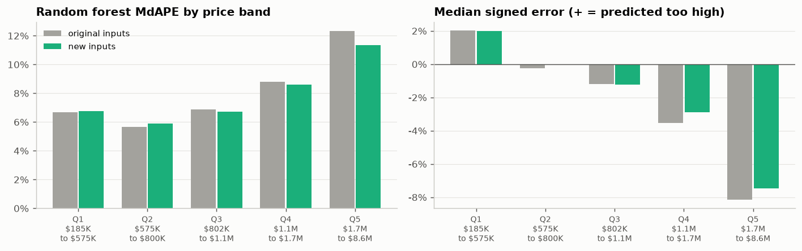

# Week 6 Meeting Memo: Feature Engineering and School Districts

**IDX Exchange Data Science Internship** · Orcun Tasdemir · October 2026
Notebook: [`notebooks/05_feature_engineering.ipynb`](../notebooks/05_feature_engineering.ipynb) · Previous week: [`04_meeting_memo.md`](04_meeting_memo.md)

*Notebooks and memos are numbered by project step, starting with 01 in Week 2, so the Week 6 files carry the number 05.*

## In one paragraph

This week I added new inputs to the three models (linear regression, decision tree, random forest), including a school-district layer built from the state's official district map, and compared the old and new input sets. The inputs suggested in the internship's Week 6 task description (age of the home, bedroom-to-bathroom ratio, school districts), and the month of sale, added little. One further input, the price per square foot of nearby recent sales, produced almost all of the gain: half of the test homes are now predicted within 9.5% of their sale price by the linear regression, against 11.4% before, and the random forest improved slightly but in every month checked. With the new inputs, training on more past months also became worthwhile. The best model so far, a random forest trained on the 24 months before the test month, predicts half of the April 2026 test homes within **7.40%** of their sale price, against 7.76% last week, and explains 90.0% of the variation in prices. (These two measures, MdAPE and R², are defined in Section 1.)

## 1. What was added

Each home already had 17 inputs (living area, lot size, bedrooms, bathrooms, year built, garage spaces, stories, association fee, latitude, longitude, five yes/no features, county and ZIP code). The new inputs were added in four steps, so that each step's contribution could be measured on its own:

| Step | New inputs | Why |
|---|---|---|
| 1 | **Age at sale** (sale year minus year built; replaces year built) and **bedroom-to-bathroom ratio** | suggested by the task; the internship's best-practices document (IDX Exchange's standard for building price-prediction models) recommends age at sale over year built |
| 2 | **Month of sale**, as the sine and cosine of 2π × month / 12 (two numbers that place the months around a circle, so December and January are neighbors), and **months since January 2024** | lets a model learn the seasonal pattern and tell older sales from recent ones |
| 3 | **School districts** from the California Department of Education's 2024-25 boundaries | the regional layer the task asks for |
| 4 | **Nearby sales price per square foot**: the median price per square foot of the nearest sales in the training months | the "comparable sales" idea used by appraisers, recommended by the best-practices document |

Everything else stayed the same as in Weeks 4 and 5: the same cleaned data and the same split by month. Each model trains on the months immediately before the month it predicts; the number of such months is the *training window*, 12 months so far. Settings are chosen on the March 2026 *validation month*, and each model gets one final score on the April 2026 *test month*. Every model predicts log price, and the same measures are used. For each home, the percentage error is |predicted price − sale price| / sale price. The headline measure is **MdAPE**, the median of these errors: half of the homes are predicted within it. **R²** is the share of the variation in prices that a model explains. **MAE** is the mean error in dollars.

## 2. The school-district layer

- **The map:** 937 districts. 345 are *unified* (all grades); in other areas, separate *elementary* and *high-school* districts overlap the same land.
- **Matching homes:** each home was placed on the map by its coordinates. 99.1% of homes fall inside a district; almost all of the rest have no coordinates.
- **Two inputs per home:** its unified district if it has one, else its elementary district; and its unified district if it has one, else its high-school district. The homes in our data fall into 686 different districts for the first input and 404 for the second (not every district on the map has sales).
- **Turning a district into a number:** like ZIP code, each district becomes the average log sale price of training homes in that district, computed so that a home's own price never counts toward its own value.

**What was deliberately left out.** The district file also contains student demographics, including shares by race and ethnicity. These are not used. Feeding a neighborhood's demographic make-up into a home-price model is a recognized fair-housing problem for valuation models, and the task asks for the district as a regional feature, not for its demographics.

## 3. The nearby-sales input

**How it works.** For each home, take the closest sales in the training months (by distance on the map) and compute the median of their price per square foot. Unlike the ZIP-code input, this follows each home's own neighborhood instead of a fixed boundary.

**Keeping it honest.** The input is computed inside the model from training sales only. When the model is trained, each training home's value comes from the *other* homes near it, never from its own sale. A check confirmed this even for two homes at identical coordinates: each uses the other, but never itself. Homes in the validation and test months use training sales only, just as the model would for a home it is asked to price today, whether or not that home is for sale.

**How many neighbors.** Values from 5 to 100 were compared on the validation month. 50 neighbors gave the lowest error and 100 was statistically tied with it, so the smoother choice, **100 neighbors**, was taken (the rule for such ties is explained next).

## 4. How settings were chosen

As agreed last week, every setting was chosen on the March 2026 validation month with the **one-standard-error rule**: among the settings whose error is within one standard error of the best, take the simplest. To get the standard error, the validation homes were resampled with replacement 2,000 times (a *bootstrap*: each resample is a random draw of the same number of homes, some appearing twice and some not at all), the difference in MdAPE between a setting and the best one was recomputed on each resample, and the standard deviation of those 2,000 differences was taken. Differences smaller than that are measurement noise and should not drive the choice.

The rule chose slightly simpler models than last week's search. The random forest now uses leaves of at least 2 homes instead of 1. For the original inputs, the decision tree is depth 16 instead of 20. With the original inputs, the forest's test-month MdAPE barely moved: 7.74% with this week's settings, against 7.76% with last week's.

## 5. What each step contributed (validation month)

- **Steps 1 to 3 add little.** The linear regression improves from 11.40% to 11.06%; the tree models do not improve.
- **Step 4, nearby sales, is the real gain:** the linear regression drops to 9.51%, and the random forest to 7.49% from about 7.75%.

Why steps 1 to 3 add so little:
- **Age at sale** carries almost the same information as year built, which the models already had.
- **The bedroom-to-bathroom ratio** is something a tree can already work out from bedrooms and bathrooms.
- **School districts are coarser than ZIP codes:** 686 districts against 1,567 ZIP codes, and the models already use ZIP code.
- **Month of sale** helps a tree little when the month being predicted lies after every month it trained on, because a tree cannot extend a trend beyond its training data.

## 6. The test month: old against new inputs

This is the comparison the task asks for, with every model trained on the same 12 months (April 2025 to March 2026) as in Weeks 4 and 5, and scored once on April 2026:

| Inputs | Linear regression | Decision tree | Random forest |
|---|---:|---:|---:|
| Original (Week 3) | 11.38% | 9.83% | 7.74% |
| + age, bed/bath ratio | 11.37% | 9.90% | 7.76% |
| + month of sale | 11.25% | 10.01% | 7.83% |
| + school districts | 11.13% | 9.82% | 7.86% |
| **+ nearby sales** | **9.50%** | **9.56%** | **7.66%** |
| R², original → all new inputs | 0.820 → 0.860 | 0.844 → 0.862 | 0.884 → 0.890 |

## 7. Are the gains real?

Two checks, as in Week 5.

**Redrawing the test homes.** With the same bootstrap as in Section 4, the test homes were resampled 2,000 times and the difference between the original and the full new inputs was recomputed each time. The middle 95% of those differences is the *95% range*: if it stays clear of zero, the gain is unlikely to be luck in which homes sold.

| Model | MdAPE gain | 95% range |
|---|---:|---:|
| Linear regression | 1.88 points | 1.65 to 2.14 |
| Decision tree | 0.27 points | 0.02 to 0.52 |
| Random forest | 0.08 points | −0.07 to 0.21 |

The linear regression's gain is clearly real. The random forest's gain on the test month alone is too small to tell apart from chance, since its range includes zero.

**All 13 months.** As agreed, the check now covers every month of 2025 plus the test month, with a separate model for each month trained on the 12 months before it:

- **The new inputs win every time.** The random forest is better in all 13 months, by 0.05 to 0.34 points (mean 0.21); the linear regression by 1.6 to 2.0 points (mean 1.77).
- **The overall reading:** for the forest, the gain is small but consistent; for the linear regression, it is large.

## 8. The training window now matters

In Week 3, a 12-month window was chosen partly because older months added stale prices that the models had no way to account for. With the month of sale as an input, the window was rechecked the way it was chosen in Week 3: on three validation months, January, February and March 2026, so that one unusual month cannot decide it. For each window length, models were trained on that many months before each validation month, and the three months' predictions were pooled. Windows were compared on the same homes; shorter windows count as simpler.

The random forest keeps improving with more months: 7.59% at 12 months against 7.43% at 24 months, a gap four times its standard error. The one-standard-error rule picks **24 months for the random forest** and 18 months for the linear regression. Each was then scored once on the test month:

"Homes within 10%" is the share of test homes whose predicted price is within 10% of the sale price.

| Model, new inputs | Training months | R² | MdAPE | MAE | Homes within 10% |
|---|---|---:|---:|---:|---:|
| **Random forest** | **24 (April 2024 to March 2026)** | **0.900** | **7.40%** | **$148,862** | **61.4%** |
| Random forest | 12 (for comparison) | 0.890 | 7.66% | $155,195 | 60.6% |
| Linear regression | 18 (October 2024 to March 2026) | 0.864 | 9.45% | $176,539 | 52.2% |

**The random forest with the new inputs and 24 months is the best model so far:** MdAPE 7.40% and R² 0.900, against 7.76% and 0.885 in Week 5. The comparison table in Section 6 keeps 12 months so that it lines up with Weeks 4 and 5; the 24-month model is reported separately for that reason.

> **Update after Week 7.** A follow-up check (Week 7 memo, Section 6) trained the forest on 12 and 24 months with both the original and the new inputs. More months helped with the original inputs too (by 0.24 points, against 0.16 with the new inputs). The 24-month gain therefore comes mainly from having more training data, not from the new inputs making older sales usable, as was suggested at the time.

## 9. Where the new inputs help

The test homes were split into five groups of nearly equal size by sale price; each range runs from the lowest to the highest sale price in the group, so the small gaps between ranges contain no homes. The last column is the *signed* error: the median of (predicted − actual) / actual, where negative means priced too low. Results are for the forest at 12 months:

| Price band | Sale prices | MdAPE, original → new | Signed error, original → new |
|---|---|---:|---:|
| Q1 | $185K to $575K | 6.69% → 6.74% | +2.0% → +2.0% |
| Q2 | $575K to $800K | 5.67% → 5.90% | −0.3% → 0.0% |
| Q3 | $802K to $1.1M | 6.87% → 6.72% | −1.2% → −1.2% |
| Q4 | $1.1M to $1.7M | 8.80% → 8.61% | −3.5% → −2.9% |
| Q5 | $1.7M to $8.6M | **12.34% → 11.34%** | **−8.2% → −7.5%** |

- **The gain is concentrated in the expensive homes,** the weak spot of every model so far: the most expensive fifth improves by a full point, and its underpricing shrinks. The cheaper bands change by a quarter point or less, and Q2 gets slightly worse (5.67% to 5.90%).
- **The month-level bias shrinks a little.** Last week's analysis found that the forest prices a whole month too low when prices had risen since its training months, and too high when they had fallen, because it could not tell when a sale happened. Measured as the signed error over all homes in a month, averaged in absolute size over the 13 evaluated months, this bias falls from 1.02% to 0.87%. It does not disappear, again because a tree cannot extend the month-of-sale trend beyond its training months.

## 10. Takeaways and next week

**Takeaways**
1. **The task's suggested features** (age, bed/bath ratio, school districts) and month of sale **add little:** age, the ratio and districts largely repeat information the models already had, and a tree cannot use the month-of-sale trend beyond its training months.
2. **The nearby-sales price per square foot is the valuable new input:** a large, real gain for the linear regression (−1.9 points) and a small but consistent one for the forest (better in 13 of 13 months).
3. **With the new inputs, a 24-month window beats 12 months,** and the resulting random forest is the **best model so far: MdAPE 7.40%, R² 0.900.**
4. **Expensive homes improve the most,** though they remain the hardest to predict.

**Week 7: gradient boosting.** I'll train gradient-boosted trees (such as LightGBM or XGBoost), where each new tree corrects the errors of the trees before it. They'll use the new input set and the 24-month window, with light tuning of depth, learning rate and number of trees, chosen with the same one-standard-error rule.

## 11. Questions that may come up

**Why did school districts not help, if location matters so much?**
Location already enters the models through ZIP code (1,567 values), coordinates and county. School districts are coarser (686), so they mostly repeat what ZIP code says. The nearby-sales input helps because it is *finer* than ZIP code, following each home's own surroundings.

**Is the nearby-sales input leaking the answer?**
No. It uses only sales from the training months, never the home's own sale, and never anything from the month being predicted. It is the same information an appraiser uses: what nearby homes recently sold for. It can also be computed for a home that is not for sale, which the model must be able to price.

**Why not use the district demographics in the file?**
Using the racial or ethnic make-up of a neighborhood as an input to a home-price model is a recognized fair-housing problem for valuation models. The task asks for the district as a regional feature, so only the district itself is used.

**Why compare the input sets at 12 months if 24 is better?**
So the comparison lines up with Weeks 4 and 5 and isolates the effect of the inputs. The window is a separate choice, made on the validation months and reported separately. Mixing the two would make it unclear which change produced which gain.

**Earlier memos said there were about 3,000 ZIP codes. Which is right?**
1,567. The earlier figure counted 9-digit postal codes (ZIP+4) as separate codes. The models always used the 5-digit ZIP code, so no result changes; the Week 3 memo has been corrected.

**Could the results change if the notebook is run again?**
No. All random steps use the same fixed seed, and the notebook was run twice with identical results.
