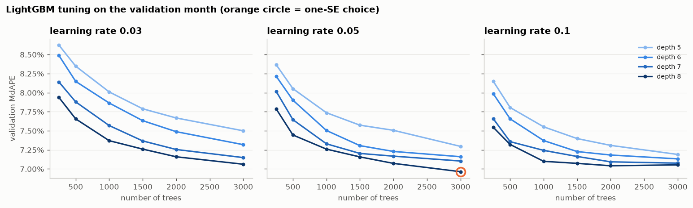
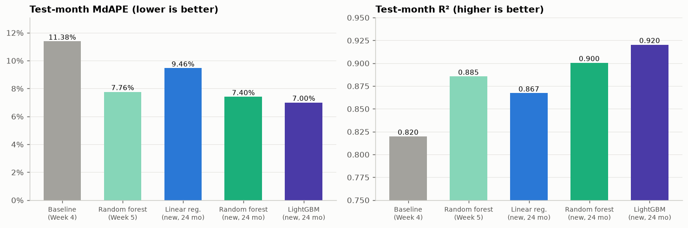
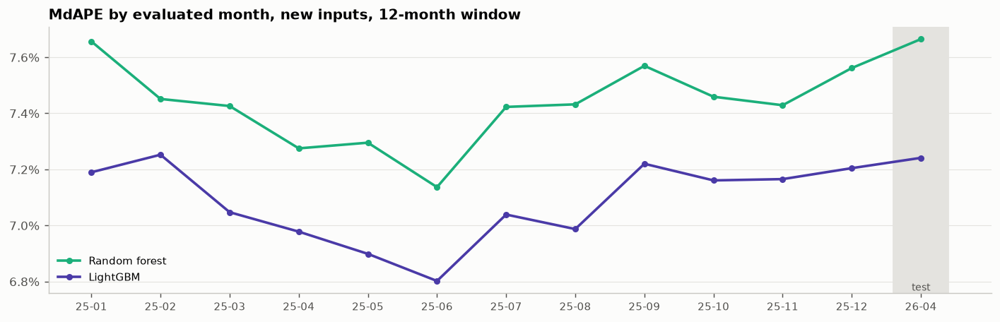
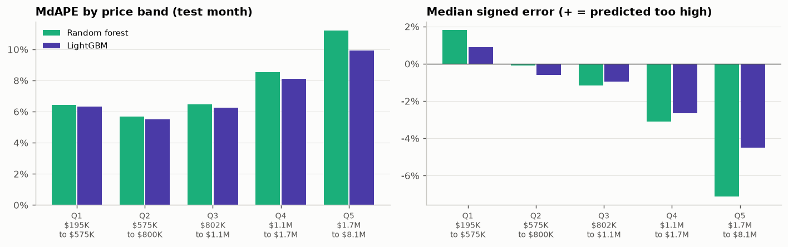
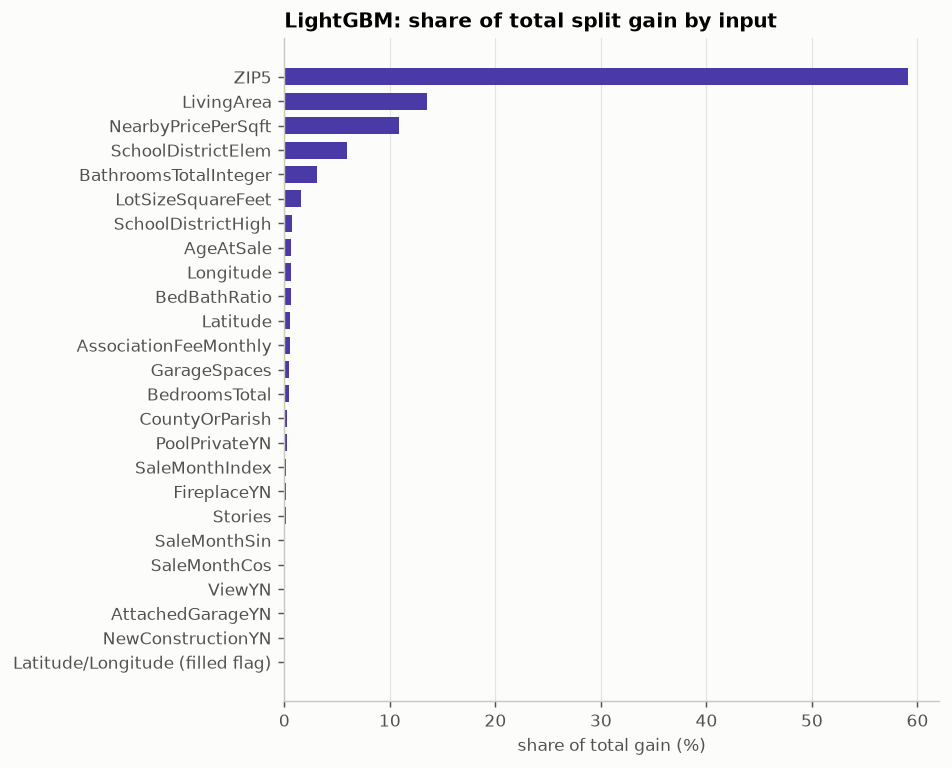

# Week 7 Meeting Memo: Gradient Boosting

**IDX Exchange Data Science Internship** · Orcun Tasdemir · November 2026
Notebook: [`notebooks/06_advanced_models.ipynb`](../notebooks/06_advanced_models.ipynb) · Previous week: [`05_meeting_memo.md`](05_meeting_memo.md)

*Notebooks and memos are numbered by project step, starting with 01 in Week 2, so the Week 7 files carry the number 06. The task document calls this notebook `05_advanced_models.ipynb`.*

## In one paragraph

This week I trained a gradient-boosted tree model (LightGBM), tuned its learning rate, depth and number of trees on the validation month, and compared it with all earlier models. **It is the new best model.** On the April 2026 test month, it predicts half of the homes within **7.00%** of their sale price, against 7.40% for last week's random forest and 11.38% for the Week 4 baseline, and it explains **92.0%** of the variation in prices (these measures are defined in Section 2). The gain over the forest is clearly real: it holds in every one of the 13 months checked (Section 5). It helps most where every earlier model struggled, the most expensive homes. I also settled a question left open last week (Section 6): training on 24 months of past sales instead of 12 helps mainly because the models get more data, not because of the new inputs added in Week 6.

## 1. What gradient boosting is

All tree-based models so far predict by asking yes/no questions about a home (for example "is the living area above 2,000 sq ft?") and averaging the prices of similar training homes. They differ in how they combine trees:

| Model | How trees are combined |
|---|---|
| Decision tree (Week 5) | a single tree |
| Random forest (Weeks 5 and 6) | hundreds of deep trees, trained **independently** on random resamples of the training homes, then **averaged** |
| **Gradient boosting (this week)** | small trees trained **one after another**: each new tree is fit to the errors the model still makes, and its prediction is **added** to the model, scaled down by a *learning rate* |

A random forest reduces noise by averaging; gradient boosting reduces error step by step. A smaller learning rate takes smaller, more careful steps and usually needs more trees. I used **LightGBM**, a widely used and fast gradient-boosting library, one of the two suggested in the internship's Week 7 task description.

## 2. Setup

Everything carries over from Week 6, so the comparison is fair:
- **Inputs:** the full Week 6 set of 24 inputs, called the *new inputs* below. They add to the 17 *original inputs* from Week 3 (living area, lot size, bedrooms, bathrooms, year built, location, ZIP code and so on) the age at sale, bedroom-to-bathroom ratio, month of sale, school districts, and the nearby-sales price per square foot (the median price per square foot of the 100 nearest sales in the training months).
- **Training window: 24 months,** the window Week 6 found best for the random forest. A model trains on the 24 months right before the month it predicts.
- **Choosing settings:** train on March 2024 to February 2026 and score the *validation month*, March 2026. (Only the training-window length was chosen differently, in Weeks 3 and 6, on three validation months, January to March 2026.)
- **Final result:** train on April 2024 to March 2026 and score the *test month*, April 2026, once.
- **Target and measures:** every model predicts the logarithm of the price, which is converted back to dollars before scoring. For each home, the percentage error is |predicted − actual| / actual. **MdAPE**, the median of these errors, is the headline: half of the homes are predicted within it. **R²** is the share of the variation in prices a model explains, and **MAE** is the mean error in dollars.

## 3. Tuning, as the task asks

Three settings were tuned on the validation month:

| Setting | Values tried |
|---|---|
| Learning rate | 0.03, 0.05, 0.1 |
| Depth (most questions per tree) | 5, 6, 7, 8, with at most 31, 63, 127 or 255 leaves per tree (one fewer than 2^depth, LightGBM's usual pairing) |
| Number of trees | 250, 500, 1,000, 1,500, 2,000, 3,000 |

All 72 combinations were scored. A boosted model can be read off after any number of trees, so each depth and learning rate needed only one training run of 3,000 trees. The choice used the **one-standard-error rule**, as in Week 6: among settings whose validation error is within one standard error of the best, take the one with the fewest total leaves (trees × leaves per tree), since smaller models are less likely to fit noise.

**Result.** The best setting, which no simpler setting came within one standard error of, is **learning rate 0.05, depth 8, 3,000 trees** (validation MdAPE 6.96%):

Each line is one depth; error falls as trees are added and is lower for deeper trees. The chosen setting is at the edge of what was tried, with the deepest trees and the most trees. Slightly larger models might therefore do a little better, but at learning rate 0.1 the curves flatten after about 2,000 trees, so the remaining gain looks small. "Light tuning" is what the task description asks for; extending the grid one step is a possible follow-up.

## 4. The test month: all models compared

This week's models were trained on April 2024 to March 2026 and scored once on April 2026. The first two rows are earlier weeks' results on the same test month, from models trained on April 2025 to March 2026 (12 months) with the original inputs.

| Model | Inputs, training months | R² | MdAPE | MAE | Homes within 10% |
|---|---|---:|---:|---:|---:|
| Linear regression (Week 4 baseline) | original, 12 | 0.820 | 11.38% | $207,051 | |
| Random forest (Week 5) | original, 12 | 0.885 | 7.76% | $159,355 | |
| Linear regression | new, 24 | 0.867 | 9.46% | $175,061 | 52.0% |
| Random forest (Week 6 best) | new, 24 | 0.900 | 7.40% | $148,862 | 61.4% |
| **LightGBM** | **new, 24** | **0.920** | **7.00%** | **$136,276** | **64.2%** |

"Homes within 10%" is the share of test homes whose predicted price is within 10% of the sale price; it was not recorded for the Week 4 and 5 models. Compared with the Week 4 baseline, the typical error has fallen by more than a third (11.38% to 7.00%), and the average dollar error by about $71,000.

## 5. Is the gain real?

**Redrawing the test homes.** As in earlier weeks, the test homes were resampled with replacement 2,000 times (a *bootstrap*), and the difference in MdAPE between two models was recomputed on each resample. The middle 95% of the differences is the *95% range*; if it stays clear of zero, the gain is unlikely to be luck in which homes sold.

| Comparison | MdAPE difference | 95% range |
|---|---:|---:|
| Random forest minus LightGBM | 0.41 points* | 0.27 to 0.58 |
| Linear regression minus LightGBM | 2.46 points | 2.27 to 2.67 |

\* Computed from unrounded values; the rounded table values (7.40% and 7.00%) differ by 0.40.

**Month by month.** The same comparison was repeated for every month of 2025 and the test month, each with its own model trained on the months before it. Here the window is 12 months, because a 24-month window cannot be trained before January 2026 (the data starts in January 2024).

LightGBM is better in **all 13 months**, by 0.20 to 0.47 points (mean 0.35). Both checks agree: the improvement is real.

## 6. Last week's open question: why does the 24-month window help?

In Week 6, the forest improved when trained on 24 instead of 12 months, and I suggested a reason: the new inputs (month of sale, nearby sales) make older sales usable. The other possibility was that the forest simply benefits from more data, whatever its inputs. To separate the two, the forest was trained with the original and with the new inputs, on 12 and on 24 months, before each of the three validation months (January to March 2026), and all four versions were scored on the same 27,484 homes. These are validation months, so the numbers differ slightly from the test-month figures in Section 4 (for example 7.43% here against 7.40% on the test month):

| Inputs | MdAPE, 12 months | MdAPE, 24 months | Gain from 24 months (95% range) |
|---|---:|---:|---:|
| Original (Week 3) | 7.86% | 7.61% | 0.24 points (0.17 to 0.33) |
| New (Week 6) | 7.60% | 7.43% | 0.16 points (0.08 to 0.24) |

**The forest gains from more months with the original inputs too, and by slightly more.** So the longer window helps mainly because the model gets more data, not because of the new inputs; last week's explanation was not supported. In hindsight, Week 3 chose 12 months using a linear regression and a quick boosted model on the original inputs, and for the forest, more data helps regardless. The Week 6 memo now carries a note with this correction.

## 7. Where LightGBM helps

The test homes were split into five groups of nearly equal size by sale price, from the cheapest fifth (Q1) to the most expensive fifth (Q5); each range runs from the lowest to the highest sale price in the group, so the small gaps between ranges contain no homes. The *signed error* is the median of (predicted − actual) / actual; negative means priced too low.

| Price band | Sale prices | MdAPE, forest → LightGBM | Signed error, forest → LightGBM |
|---|---|---:|---:|
| Q1 | $195K to $575K | 6.43% → 6.31% | +1.8% → +0.9% |
| Q2 | $575K to $800K | 5.69% → 5.50% | −0.1% → −0.6% |
| Q3 | $802K to $1.1M | 6.46% → 6.24% | −1.2% → −1.0% |
| Q4 | $1.1M to $1.7M | 8.53% → 8.09% | −3.1% → −2.7% |
| Q5 | $1.7M to $8.1M | **11.22% → 9.91%** | **−7.1% → −4.5%** |

- **The biggest gain is for the most expensive fifth of homes,** the band every model since Week 4 has priced too low (the Week 4 baseline by 11.3%, the Week 6 forest by 7.1% here). Their error falls by 1.3 points, and the typical underpricing shrinks from 7.1% to 4.5%.
- **The cheaper bands improve slightly** (0.1 to 0.2 points), though in Q2 LightGBM leans a little more toward pricing too low (−0.6% against −0.1%).
- **Why:** a forest averages hundreds of trees, which pulls its highest predictions toward the middle. Boosting adds trees that specifically correct the remaining errors, and the largest remaining errors are the underpriced expensive homes. LightGBM's highest test prediction is $7.8 million, against the forest's $7.0 million (the most expensive training sale is $8.3 million).
- **The month-level bias also shrinks slightly.** For each of the 13 months in Section 5, the signed error over all of that month's homes measures whether the model priced the month as a whole too low or too high. Averaging the size of that bias (ignoring its sign) over the 13 months gives 0.87% for the forest and 0.77% for LightGBM.

## 8. What LightGBM relies on

Each time a tree splits on an input, the training error drops by some amount (its *gain*). Adding up the gain by input shows what the model leans on:
- **ZIP code: 59%,** the local price level.
- **Living area: 14%.**
- **Nearby-sales price per square foot: 11%.**
- **Elementary school district: 6%.**
- **Everything else: under 3% each.**

Gain shares favor inputs with many different values, so this shows what the model uses, not what each input would be worth on its own. The picture matches every earlier week: location first, size second.

## 9. Takeaways and next week

**Takeaways**
1. **LightGBM is the best model so far:** MdAPE **7.00%**, R² **0.920**, with 64% of homes within 10% of their sale price.
2. **Its gain over the random forest is real:** 0.41 points on the test month (range 0.27 to 0.58), and better in all 13 months checked.
3. **It fixes much of the underpricing of expensive homes:** the typical error for the most expensive fifth goes from −7.1% to −4.5%.
4. **The 24-month window helps because of more data,** not because of the new inputs, which corrects last week's explanation.

**Week 8: evaluation.** The Week 8 task asks for MAPE (the mean percentage error) and MdAPE broken down by price band, with a saved `metrics_summary.csv`; the internship's best-practices document (IDX Exchange's standard for price-prediction models) also suggests a breakdown by area. The final model for that is LightGBM with the new inputs and 24 months.

## Questions that may come up

**Why is gradient boosting usually better than a random forest?**
A forest's trees are trained independently, so they all make many of the same mistakes, and averaging cannot remove those. Boosting trains each tree on the errors that remain, so later trees concentrate on the homes the model still gets wrong, such as unusual or expensive homes.

**Were the settings chosen by looking at the test month?**
No. The LightGBM and random forest settings were chosen on the March 2026 validation month, and the training-window length on January to March 2026; April 2026 was used once per model for the final score.

**Why is the month-by-month check at 12 months when the model uses 24?**
The data starts in January 2024. A 24-month window needs 24 months of history, so it can only be evaluated from January 2026 on, and January to March 2026 were already used for choosing the training window and the settings. The month-by-month check therefore uses the 12-month window, which can be evaluated across all of 2025.

**Could the results change if the notebook is run again?**
No. All random steps use the same fixed seed, and LightGBM runs in its deterministic mode with a fixed number of threads, so reruns give identical results.
