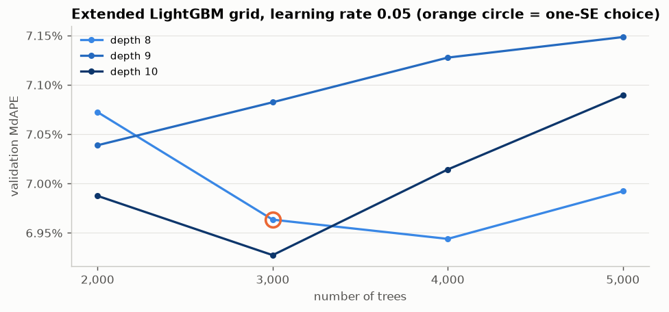
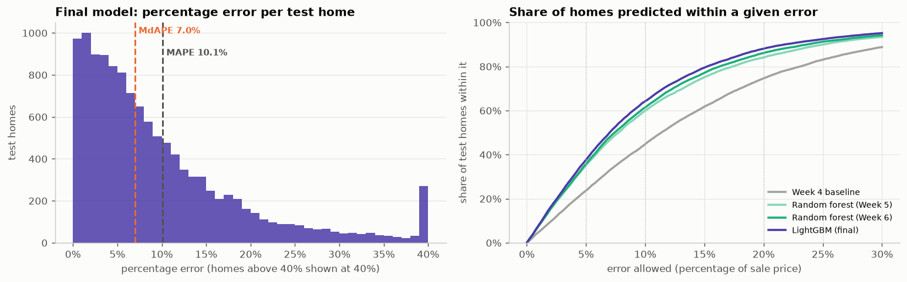
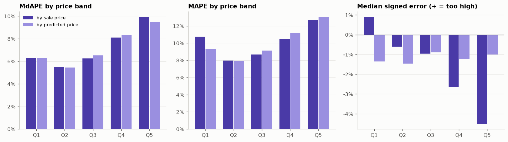
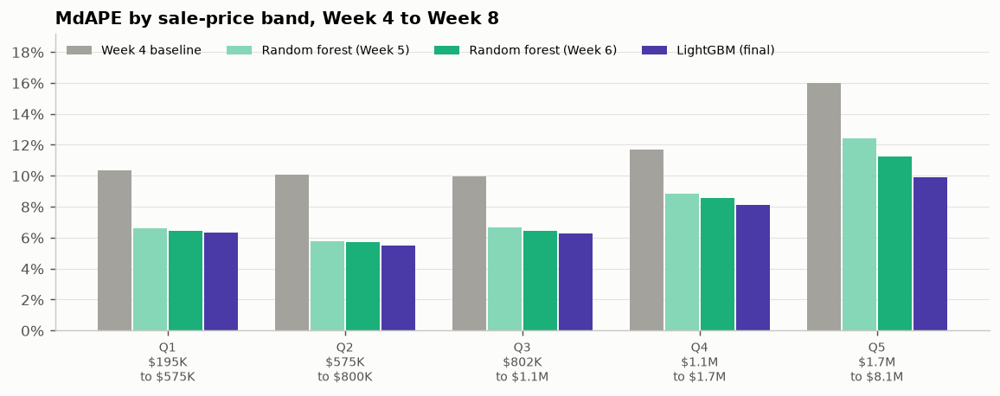
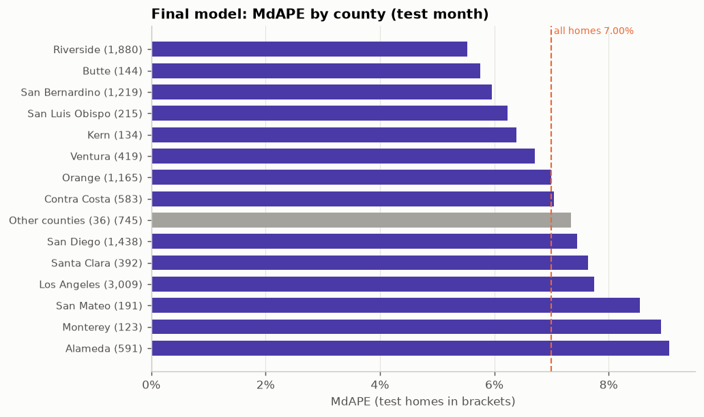
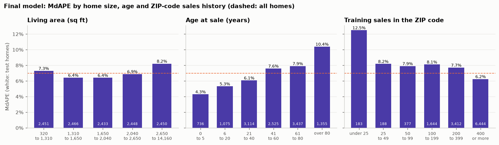

# Week 8 Meeting Memo: Evaluation

**IDX Exchange Data Science Internship** · Orcun Tasdemir · November 2026
Notebook: [`notebooks/07_evaluation.ipynb`](../notebooks/07_evaluation.ipynb) · Summary table: [`results/metrics_summary.csv`](../results/metrics_summary.csv) · Previous week: [`06_meeting_memo.md`](06_meeting_memo.md)

*Notebooks and memos are numbered by project step, starting with 01 in Week 2, so the Week 8 files carry the number 07. The internship's task document (the week-by-week plan) calls this notebook `06_evaluation.ipynb`.*

## In one paragraph

This week I evaluated the final model, last week's LightGBM, in more depth than one headline number. On the April 2026 test month it predicts half of the homes within **7.00%** of their sale price, and **64%** of homes within 10%. All five models built so far are now compared on the same measures in one table, `metrics_summary.csv` (Section 3). The model is most accurate for newer homes, mid-priced homes, and Riverside and San Bernardino counties, and least accurate for very old homes, the most expensive homes, ZIP codes with few past sales, and Alameda and Monterey counties (Sections 5 to 7). Its largest misses are mostly homes that the model priced too high, because they sold for less per square foot than typical homes (Section 8). It also prices the typical home about 1% too low in spring, when prices are rising (Section 9). First, though, Section 2 settles a point left open last week: the chosen LightGBM setting was the largest one tried, and trying larger ones does not change the choice.

## 1. What this week asks, and the measures

The Week 8 task asks for measures beyond R², namely MAPE and MdAPE, a summary of where the model performs better or worse (for example by price band), and a saved `metrics_summary.csv`. The internship's best-practices document (IDX Exchange's guidelines for price-prediction models) adds RMSE, a breakdown by area, and a comparison across several months.

For each test home, the **percentage error** is |predicted − sale price| / sale price. The measures:

| Measure | Meaning |
|---|---|
| **MdAPE** (headline) | median percentage error: half of the homes are predicted at least this well |
| **MAPE** | mean percentage error |
| **Within 10%** | share of homes predicted within 10% of the sale price (also reported for 5% and 20%) |
| **MAE** | mean error in dollars |
| **RMSE** | root mean squared error in dollars; it weighs large misses more heavily than MAE does |
| **R²** | share of the variation in sale prices that the predictions explain |
| **Signed error** | median of (predicted − sale price) / sale price; negative means priced too low, positive means priced too high |

The setup is unchanged from Week 7:
- **Inputs:** the 17 *original inputs* from Week 3 (living area, lot size, bedrooms, bathrooms, year built, location, ZIP code and so on), or the 24 *new inputs* from Week 6, which add age at sale, bedroom-to-bathroom ratio, month of sale, school districts, and the median price per square foot of the 100 nearest past sales.
- **Choosing settings:** a model is trained on March 2024 to February 2026 and scored on the *validation month*, March 2026.
- **Final model:** once the settings are fixed, the model is retrained on the 24 months right before the test month, April 2024 to March 2026 (now including March), and scored once on the *test month*, April 2026 (12,248 homes).

The final model is LightGBM with the 24 new inputs.

## 2. First, last week's open point: the edge of the tuning grid

Last week's chosen setting (learning rate 0.05, depth 8, 3,000 trees) was the deepest and largest one tried, so larger settings might have done better. (The *depth* limits how many yes/no questions each tree may ask.) I extended the grid on the validation month to depths 8, 9 and 10 with up to 5,000 trees:

| Setting | Validation MdAPE |
|---|---:|
| Depth 10, 3,000 trees (lowest) | 6.927% |
| Depth 8, 4,000 trees | 6.944% |
| **Depth 8, 3,000 trees (Week 7 choice)** | **6.963%** |
| Depth 9, any number of trees | 7.04% to 7.15% |

The lowest error is only 0.036 points below the Week 7 choice. To judge whether such a gap is real, I resampled the validation homes 2,000 times and recomputed the gap each time; its *standard error* (the spread of the gap across resamples) is 0.064 points. The *one-standard-error rule* used since Week 6 picks the simplest setting whose gap to the best is at most one standard error, so it keeps the Week 7 setting. The curves also show no consistent pattern (depth 9 is worse than both depth 8 and depth 10), which is what one expects when the remaining differences are noise. **The final model is unchanged.**

## 3. All measures, all models

Every model was scored on the April 2026 test month. The first two rows are the Week 4 baseline and the best Week 5 model, which used the original inputs and the 12 months before the test month; the other three use the new inputs and 24 months. The Week 4 and Week 5 models were retrained with their saved settings to get the new measures, and they reproduce their earlier scores exactly.

| Model | Inputs (count), training months | R² | MAE | RMSE | MAPE | MdAPE | Within 5% | Within 10% | Within 20% |
|---|---|---:|---:|---:|---:|---:|---:|---:|---:|
| Week 4 baseline: linear regression | original 17, 12 | 0.820 | $207,051 | $408,669 | 15.17% | 11.38% | 23.6% | 44.7% | 74.5% |
| Week 5: random forest | original 17, 12 | 0.885 | $159,355 | $325,799 | 11.42% | 7.76% | 35.1% | 59.8% | 84.0% |
| Linear regression | new 24, 24 | 0.867 | $175,061 | $347,560 | 13.10% | 9.46% | 27.8% | 52.0% | 80.9% |
| Week 6: random forest | new 24, 24 | 0.900 | $148,862 | $300,880 | 10.81% | 7.40% | 35.7% | 61.4% | 86.2% |
| **LightGBM (final)** | **new 24, 24** | **0.920** | **$136,276** | **$269,320** | **10.12%** | **7.00%** | **37.6%** | **64.2%** | **88.1%** |

LightGBM is best on every measure. Compared with the Week 4 baseline, the typical percentage error fell from 11.38% to 7.00%, and the share of homes within 10% rose from 45% to 64%.

**How precise are these numbers?** I resampled the test homes with replacement 1,000 times and recomputed each measure on every resample; the middle 95% of the results is the *95% range*. It shows how much a measure would move with a different set of homes from the same month.

| Final model | Value | 95% range |
|---|---:|---:|
| MdAPE | 7.00% | 6.86% to 7.13% |
| MAPE | 10.12% | 9.91% to 10.34% |
| Within 10% | 64.2% | 63.4% to 65.1% |
| R² | 0.920 | 0.913 to 0.927 |
| MAE | $136,276 | $132,039 to $140,730 |

## 4. Home by home: why MAPE is higher than MdAPE

**Left:** most homes are predicted closely, but there is a long tail of large misses. The mean (MAPE, 10.1%) is pulled up by that tail, while the median (MdAPE, 7.0%) is not:
- Adding up the percentage errors of all test homes, the worst 5% of homes contribute 22% of the sum, and the worst 10% contribute 35%.
- Leaving out only the worst 1% of homes lowers MAPE from 10.12% to 9.45%; MdAPE barely changes.
- 7.6% of homes are off by more than 25%, and 1.2% by more than 50%.

This is why MdAPE is the headline measure, as the best-practices document recommends: it describes the typical home and is not driven by a few unusual sales.

**Right:** for any allowed error on the horizontal axis, the share of homes predicted within it. LightGBM's curve is the highest at every point, so it is ahead whichever cutoff one picks, not only at 10%.

## 5. By price band

The test homes were split into five groups of nearly equal size, Q1 (cheapest) to Q5 (most expensive). There are two ways to do this:
- **By sale price,** as the task asks and as in earlier weeks.
- **By predicted price,** which is what a user of the model sees: they have the prediction, not the eventual sale price.

Each range runs from the lowest to the highest price in the band, so small gaps between ranges contain no homes. (The chart below also shows MAPE for the predicted-price bands.)

| Band | By sale price: range | MdAPE | MAPE | Signed | By predicted price: range | MdAPE | Signed |
|---|---|---:|---:|---:|---|---:|---:|
| Q1 | $195K to $575K | 6.31% | 10.76% | +0.9% | $202K to $579K | 6.31% | −1.4% |
| Q2 | $575K to $800K | **5.50%** | 7.98% | −0.6% | $579K to $796K | **5.45%** | −1.5% |
| Q3 | $802K to $1.1M | 6.24% | 8.66% | −1.0% | $796K to $1.1M | 6.54% | −0.9% |
| Q4 | $1.1M to $1.7M | 8.09% | 10.47% | −2.7% | $1.1M to $1.6M | 8.31% | −1.2% |
| Q5 | $1.7M to $8.1M | 9.91% | 12.72% | **−4.5%** | $1.6M to $7.8M | 9.49% | **−1.0%** |

- **Mid-priced homes ($575K to $800K) are predicted best,** at about 5.5%. The most expensive fifth is the hardest, at about 9.5% to 10%.
- **The two groupings agree on the error size but not on its direction.** By sale price, the top band looks underpriced by 4.5%. By predicted price, every band is underpriced by a similar 1% to 1.5%.
- **Why they differ:** a model predicts roughly what similar homes in the same area sell for. A home that sold for *more* than similar homes is therefore predicted below its sale price, and its high sale price tends to put it in the top sale-price band. So grouping by sale price gathers these homes in the top band, which makes that band look underpriced. In the same way, homes that sold for *less* than similar homes gather in the bottom band, which looks overpriced (+0.9% in Q1). Grouping by predicted price does not sort homes by how their sale compared with similar homes, so this effect disappears.
- **So, for a user,** who sees only the prediction, expensive predictions are about as low as cheap ones (1.0% against 1.4%). The model is less precise for expensive homes, but it does not price them systematically lower than other homes. All bands are slightly low; Section 9 explains why.

**Progress since Week 4,** by sale-price band, on the 12,248 test homes all models scored:

The most expensive fifth improved most, from 15.99% (Week 4 baseline) to 12.42% (Week 5 forest), 11.22% (Week 6 forest) and 9.91% (LightGBM). The cheapest fifth went from 10.35% to 6.31%.

## 6. By county

Counties with at least 100 test homes are shown separately; the other 36 counties are grouped.

- **Most accurate:** Riverside (5.5%, 1,880 homes), Butte (5.8%) and San Bernardino (6.0%), all inland counties with lower prices (median sale price $434K to $639K).
- **Least accurate:** Alameda (9.1%, 591 homes), Monterey (8.9%) and San Mateo (8.6%). These are higher-priced coastal and Bay Area counties, where very different homes often sit close together, so location and size likely explain less of the price.
- **Los Angeles,** the largest county with 3,009 test homes, is close to the overall figure at 7.8%; San Diego is at 7.5% and Orange at 7.0%.

## 7. By home age, size and ZIP-code sales history

- **Age matters most.** MdAPE is 4.3% for homes up to 5 years old, 5.3% for homes 6 to 20 years old, and 10.4% for homes over 80 years old. The model's inputs include no information on a home's condition or renovations, and these vary much more among older homes.
- **Size:** mid-sized homes (1,310 to 2,040 sq ft) are predicted best (6.4%); the largest fifth (over 2,650 sq ft) is hardest (8.2%).
- **ZIP-code sales history.** The ZIP code is the model's strongest input (Week 7), and the model learns its price level from the ZIP code's past sales. MdAPE is 12.5% for homes in ZIP codes with fewer than 25 sales in the 24 training months (183 homes), and 6.2% for ZIP codes with 400 or more (6,444 homes).

## 8. The largest misses

I compared the 5% of test homes with the largest errors (613 homes, all off by more than 29.7%) with the other 95%. Only group summaries were computed, no individual homes are shown.

| | Largest 5% of errors | Other 95% |
|---|---:|---:|
| Priced too high (prediction above sale price) | **75%** | 44% |
| Median sale price | $906K | $915K |
| Median predicted price | $1.1M | $912K |
| Median sale price per sq ft | **$479** | $545 |
| Median age | **61 years** | 49 years |
| New construction | 0.5% | 3.2% |
| ZIP code with under 50 training sales | 5.4% | 2.9% |

Three out of four of the largest misses are priced **too high**: these homes sold for about the same prices as typical homes, but for less per square foot, and the model predicted them higher (median $1.1M). Together with their higher age, this fits homes that needed work or were sold under unusual conditions, which the model's inputs do not record. By county, Alameda homes make up 9.1% of the largest misses but only 4.8% of all test homes; Orange homes make up 3.9% of the largest misses but 9.5% of all test homes.

## 9. Stability over time, and a spring lag

The best-practices document asks for the same measures over several months, since one test month can be lucky or unlucky. Week 7 did this: LightGBM and the random forest were trained before each month of 2025 and before the test month, and scored on that month (13 months). Because the data starts in January 2024, a 24-month window cannot be trained before 2026, so these runs use a 12-month window. Across those months:

| | MdAPE, lowest | MdAPE, highest | MdAPE, mean | R², range |
|---|---:|---:|---:|---:|
| Random forest | 7.14% | 7.67% | 7.44% | 0.89 to 0.91 |
| **LightGBM** | **6.80%** | **7.25%** | **7.09%** | **0.91 to 0.93** |

So the April 2026 result is typical, not a lucky month. The same runs show a **seasonal pattern in the signed error**: the model priced the typical home too low in February to April 2025 (by 2.3%, 1.8% and 1.2%) and slightly too high in July (+0.8%). April 2026 is again too low (by 1.2% for the final model). Spring is when prices rise: the median sale price per square foot went from $499 in January 2026 to $529 in March and $543 in April. A model trained only on past sales lags such a rise. One of the Week 6 inputs counts the months since the start of the data, but a tree model treats every month after the last training month like that last month, so it cannot continue a rising trend. Adjusting predictions for the most recent price trend is a possible improvement.

## 10. Takeaways and next week

**Takeaways**
1. **Final model:** LightGBM, unchanged after the grid check. On the test month: MdAPE **7.00%** (95% range 6.86% to 7.13%), MAPE 10.12%, R² 0.920, MAE $136,276, RMSE $269,320, with **64%** of homes within 10% and **88%** within 20%. The full table is in `results/metrics_summary.csv`.
2. **Best performance:** mid-priced homes (5.5%), homes up to 20 years old (4.3% to 5.3%), Riverside and San Bernardino counties (5.5% to 6.0%), and ZIP codes with many past sales (6.2%).
3. **Weakest performance:** homes over 80 years old (10.4%), the most expensive fifth (9.5% to 9.9%), ZIP codes with few past sales (12.5%), and Alameda and Monterey counties (about 9%).
4. **The underpricing of expensive homes reported in earlier weeks (4.5% this week) comes mostly from grouping by sale price.** Grouped by prediction, all price bands are about 1% to 1.5% low, which matches the spring lag.
5. **The largest misses** are mostly older homes that sold for less than similar nearby homes, likely because of condition, which the model's inputs do not record.

**Possible improvements** (not in the task plan): adjust for the most recent price trend, and borrow the price level of neighboring ZIP codes when a ZIP code has few past sales.

**Week 9 (optional): a simple prediction app.** The task asks for a Streamlit app (Streamlit is a Python library for simple web pages) where a user enters living area, bedrooms, bathrooms and lot size and gets a predicted price. The final model uses 24 inputs and depends most on location (the ZIP code was its strongest input in Week 7), so the app also needs the home's location (for example a ZIP code or an address). The other inputs can be filled with typical values for that area. I suggest building the app this way.

## Questions that may come up

**Why do MAPE and MdAPE differ so much (10.1% against 7.0%)?**
A few very large misses pull the mean up: the worst 5% of homes contribute 22% of the sum of all percentage errors. The median describes the typical home and is barely affected by them.

**Did the grid extension use the test month?**
No. All settings, including the extended grid, were compared on the March 2026 validation month. The test month was used once, for the final scores.

**Is the model biased against expensive homes?**
Not in the way earlier weeks suggested. Grouped by sale price, the top band looks 4.5% low, but grouped by predicted price, which is what a user sees, every band is 1% to 1.5% low. The model is less precise for expensive homes (about 9.5% against 5.5% for mid-priced homes), but not systematically lower for them than for others.

**Why is the model worse for old homes?**
The model's inputs include no information on condition or renovations. Among new homes this hardly varies, but among 80-year-old homes it ranges from original condition to fully rebuilt, and the price follows.

**Could the results change if the notebook is run again?**
No. All random steps use the same fixed seed and LightGBM runs in its deterministic mode, so reruns give identical results. The retrained Week 4 and Week 5 models reproduce their saved scores exactly.
